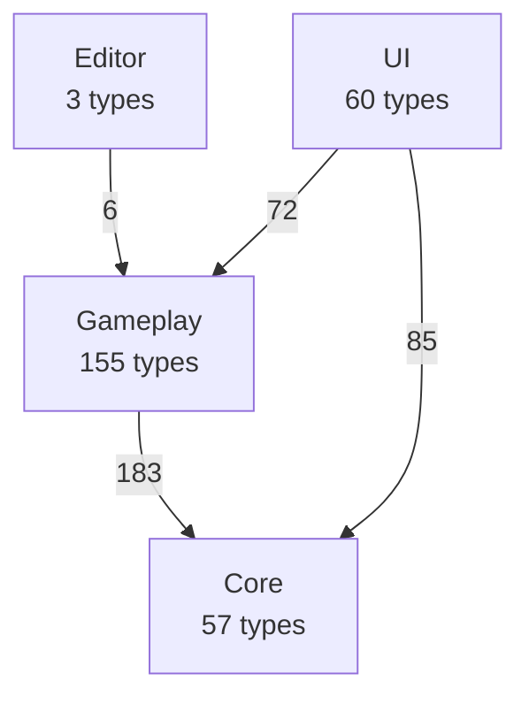

# Overview — layers & modules

[← index](README.md)

Intended direction: **Editor → UI → Gameplay → Core**. Red edges point the wrong way.

## Layer dependencies

Label = distinct type-to-type links.

## Module dependencies

Box = folder module (types · LOC). Edge label = distinct type pairs; edges under 3 pairs hidden.

```mermaid
flowchart LR
  subgraph L_Editor["Editor layer"]
    M_Editor["Editor<br/>3 types · 576 LOC"]
  end
  subgraph L_UI["UI layer"]
    M_UI["UI<br/>16 types · 727 LOC"]
    M_UI_Dialogue["UI/Dialogue<br/>1 types · 19 LOC"]
    M_UI_Interactions["UI/Interactions<br/>1 types · 26 LOC"]
    M_UI_Inventory["UI/Inventory<br/>3 types · 393 LOC"]
    M_UI_Inventory_InventoryBin["UI/Inventory/InventoryBin<br/>1 types · 56 LOC"]
    M_UI_Inventory_InventoryBuy["UI/Inventory/InventoryBuy<br/>2 types · 70 LOC"]
    M_UI_Inventory_InventoryPlayer["UI/Inventory/InventoryPlayer<br/>2 types · 100 LOC"]
    M_UI_Loading["UI/Loading<br/>2 types · 46 LOC"]
    M_UI_Loading_LoadingTextAnimation["UI/Loading/LoadingTextAnimation<br/>1 types · 19 LOC"]
    M_UI_Loading_LoadingVisualController["UI/Loading/LoadingVisualController<br/>2 types · 34 LOC"]
    M_UI_Money["UI/Money<br/>1 types · 41 LOC"]
    M_UI_Notifications["UI/Notifications<br/>5 types · 180 LOC"]
    M_UI_Ocean["UI/Ocean<br/>1 types · 73 LOC"]
    M_UI_Quest["UI/Quest<br/>6 types · 493 LOC"]
    M_UI_QuestCompleteUI["UI/QuestCompleteUI<br/>1 types · 104 LOC"]
    M_UI_Save["UI/Save<br/>2 types · 141 LOC"]
    M_UI_Shop["UI/Shop<br/>2 types · 354 LOC"]
    M_UI_UIManager["UI/UIManager<br/>4 types · 389 LOC"]
    M_UI_UIMenuSetting["UI/UIMenuSetting<br/>3 types · 137 LOC"]
    M_UI_Upgrades["UI/Upgrades<br/>3 types · 415 LOC"]
    M_UI_VFX["UI/VFX<br/>1 types · 102 LOC"]
  end
  subgraph L_Gameplay["Gameplay layer"]
    M_Gameplay_AudioSetting["Gameplay/AudioSetting<br/>7 types · 241 LOC"]
    M_Gameplay_Contracts["Gameplay/Contracts<br/>4 types · 28 LOC"]
    M_Gameplay_Cutscenes["Gameplay/Cutscenes<br/>5 types · 304 LOC"]
    M_Gameplay_Entities["Gameplay/Entities<br/>7 types · 322 LOC"]
    M_Gameplay_Entities_Enemies["Gameplay/Entities/Enemies<br/>2 types · 165 LOC"]
    M_Gameplay_Entities_Enemies_Behaviours["Gameplay/Entities/Enemies/Behaviours<br/>1 types · 97 LOC"]
    M_Gameplay_Entities_Enemies_Brain["Gameplay/Entities/Enemies/Brain<br/>8 types · 363 LOC"]
    M_Gameplay_Entities_Enemies_Brain_FSM["Gameplay/Entities/Enemies/Brain/FSM<br/>3 types · 143 LOC"]
    M_Gameplay_Entities_Enemies_Brain_FSM_States["Gameplay/Entities/Enemies/Brain/FSM/States<br/>6 types · 712 LOC"]
    M_Gameplay_Entities_Enemies_Brain_Interfaces["Gameplay/Entities/Enemies/Brain/Interfaces<br/>5 types · 30 LOC"]
    M_Gameplay_Entities_Enemies_Brain_LinearPatrol["Gameplay/Entities/Enemies/Brain/LinearPatrol<br/>5 types · 218 LOC"]
    M_Gameplay_Entities_Enemies_NavAgents["Gameplay/Entities/Enemies/NavAgents<br/>3 types · 162 LOC"]
    M_Gameplay_Entities_Enemies_NavAgents_Core["Gameplay/Entities/Enemies/NavAgents/Core<br/>5 types · 464 LOC"]
    M_Gameplay_Entities_Enemies_PartBreak["Gameplay/Entities/Enemies/PartBreak<br/>1 types · 19 LOC"]
    M_Gameplay_Entities_NPCs["Gameplay/Entities/NPCs<br/>1 types · 243 LOC"]
    M_Gameplay_Entities_Players["Gameplay/Entities/Players<br/>10 types · 941 LOC"]
    M_Gameplay_Entities_Players_OxygenTube["Gameplay/Entities/Players/OxygenTube<br/>8 types · 763 LOC"]
    M_Gameplay_Environments["Gameplay/Environments<br/>7 types · 480 LOC"]
    M_Gameplay_Game["Gameplay/Game<br/>1 types · 132 LOC"]
    M_Gameplay_Interaction["Gameplay/Interaction<br/>1 types · 90 LOC"]
    M_Gameplay_Inventory["Gameplay/Inventory<br/>5 types · 223 LOC"]
    M_Gameplay_Items["Gameplay/Items<br/>2 types · 55 LOC"]
    M_Gameplay_Items_Pickups["Gameplay/Items/Pickups<br/>3 types · 219 LOC"]
    M_Gameplay_Items_Placeables["Gameplay/Items/Placeables<br/>1 types · 10 LOC"]
    M_Gameplay_MainCameras["Gameplay/MainCameras<br/>2 types · 40 LOC"]
    M_Gameplay_Projectiles["Gameplay/Projectiles<br/>5 types · 226 LOC"]
    M_Gameplay_QuestSystems_Quest["Gameplay/QuestSystems/Quest<br/>36 types · 1739 LOC"]
    M_Gameplay_RopeSystems["Gameplay/RopeSystems<br/>1 types · 49 LOC"]
    M_Gameplay_Save["Gameplay/Save<br/>1 types · 192 LOC"]
    M_Gameplay_Services["Gameplay/Services<br/>2 types · 146 LOC"]
    M_Gameplay_Spawning["Gameplay/Spawning<br/>7 types · 478 LOC"]
  end
  subgraph L_Core["Core layer"]
    M_Core["Core<br/>8 types · 123 LOC"]
    M_Core_Datas["Core/Datas<br/>3 types · 19 LOC"]
    M_Core_Datas_Items["Core/Datas/Items<br/>3 types · 60 LOC"]
    M_Core_Datas_ScriptableDatas_Characters["Core/Datas/ScriptableDatas/Characters<br/>2 types · 27 LOC"]
    M_Core_Datas_Upgrades["Core/Datas/Upgrades<br/>3 types · 31 LOC"]
    M_Core_Events["Core/Events<br/>11 types · 106 LOC"]
    M_Core_Inputs["Core/Inputs<br/>1 types · 137 LOC"]
    M_Core_Inputs_KeyBind["Core/Inputs/KeyBind<br/>2 types · 350 LOC"]
    M_Core_Inputs_KeyBind_MoveDirection["Core/Inputs/KeyBind/MoveDirection<br/>1 types · 7 LOC"]
    M_Core_Inputs_KeyBind_SaveKeyBind["Core/Inputs/KeyBind/SaveKeyBind<br/>3 types · 28 LOC"]
    M_Core_Inputs_KeyBind_UIKeyBind["Core/Inputs/KeyBind/UIKeyBind<br/>3 types · 143 LOC"]
    M_Core_Pool["Core/Pool<br/>2 types · 76 LOC"]
    M_Core_Save["Core/Save<br/>7 types · 246 LOC"]
    M_Core_Save_DayReset["Core/Save/DayReset<br/>3 types · 107 LOC"]
    M_Core_Scenes["Core/Scenes<br/>4 types · 169 LOC"]
    M_Core_VideoManager["Core/VideoManager<br/>1 types · 70 LOC"]
  end
  M_Core_Inputs_KeyBind_UIKeyBind -->|3| M_Core_Inputs_KeyBind
  M_Core_Save -->|3| M_Core
  M_Core_Save_DayReset -->|6| M_Core_Save
  M_Editor -->|6| M_Gameplay_QuestSystems_Quest
  M_Gameplay_Cutscenes -->|3| M_Core
  M_Gameplay_Cutscenes -->|3| M_Core_Events
  M_Gameplay_Cutscenes -->|3| M_Gameplay_QuestSystems_Quest
  M_Gameplay_Entities_Enemies -->|3| M_Gameplay_Entities
  M_Gameplay_Entities_Enemies -->|3| M_Gameplay_Entities_Players
  M_Gameplay_Entities_Enemies_Brain -->|6| M_Gameplay_Entities_Enemies_Brain_FSM_States
  M_Gameplay_Entities_Enemies_Brain -->|5| M_Gameplay_Entities_Enemies_Brain_Interfaces
  M_Gameplay_Entities_Enemies_Brain -->|3| M_Gameplay_Entities_Enemies_NavAgents_Core
  M_Gameplay_Entities_Enemies_Brain_FSM_States -->|18| M_Gameplay_Entities_Enemies_Brain
  M_Gameplay_Entities_Enemies_Brain_FSM_States -->|18| M_Gameplay_Entities_Enemies_Brain_FSM
  M_Gameplay_Entities_Enemies_Brain_FSM_States -->|6| M_Gameplay_Entities_Enemies_NavAgents_Core
  M_Gameplay_Entities_Enemies_Brain_LinearPatrol -->|3| M_Gameplay_Entities_Enemies_Brain_Interfaces
  M_Gameplay_Entities_Enemies_NavAgents -->|3| M_Gameplay_Entities_Enemies_Brain
  M_Gameplay_Entities_NPCs -->|7| M_Gameplay_QuestSystems_Quest
  M_Gameplay_Entities_Players -->|6| M_Core
  M_Gameplay_Entities_Players -->|3| M_Core_Datas_Items
  M_Gameplay_Entities_Players -->|4| M_Core_Datas_Upgrades
  M_Gameplay_Entities_Players -->|4| M_Core_Events
  M_Gameplay_Entities_Players -->|4| M_Core_Save
  M_Gameplay_Entities_Players -->|4| M_Gameplay_Entities
  M_Gameplay_Entities_Players -->|3| M_Gameplay_Entities_Players_OxygenTube
  M_Gameplay_Entities_Players -->|5| M_Gameplay_QuestSystems_Quest
  M_Gameplay_Entities_Players -->|4| M_Gameplay_Services
  M_Gameplay_Entities_Players_OxygenTube -->|3| M_Core_Events
  M_Gameplay_Environments -->|4| M_Gameplay_AudioSetting
  M_Gameplay_Environments -->|4| M_Gameplay_Entities_Players
  M_Gameplay_Environments -->|4| M_Gameplay_QuestSystems_Quest
  M_Gameplay_Game -->|5| M_Core
  M_Gameplay_Game -->|4| M_Core_Events
  M_Gameplay_Game -->|3| M_Core_Scenes
  M_Gameplay_Interaction -->|3| M_Core_Events
  M_Gameplay_Inventory -->|6| M_Core_Datas_Items
  M_Gameplay_Items_Pickups -->|3| M_Core_Pool
  M_Gameplay_Projectiles -->|3| M_Gameplay_Entities_Players
  M_Gameplay_QuestSystems_Quest -->|12| M_Core
  M_Gameplay_QuestSystems_Quest -->|24| M_Core_Events
  M_Gameplay_QuestSystems_Quest -->|4| M_Core_Save
  M_Gameplay_QuestSystems_Quest -->|3| M_Gameplay_Cutscenes
  M_Gameplay_QuestSystems_Quest -->|6| M_Gameplay_Entities_Players
  M_Gameplay_QuestSystems_Quest -->|3| M_Gameplay_Environments
  M_Gameplay_QuestSystems_Quest -->|4| M_Gameplay_Inventory
  M_Gameplay_Save -->|5| M_Core_Save
  M_Gameplay_Save -->|3| M_Core_Save_DayReset
  M_Gameplay_Save -->|3| M_Core_Scenes
  M_Gameplay_Save -->|3| M_Gameplay_Entities_Players
  M_Gameplay_Services -->|3| M_Core_Events
  M_Gameplay_Services -->|4| M_Core_Save
  M_Gameplay_Spawning -->|3| M_Core
  M_Gameplay_Spawning -->|3| M_Core_Pool
  M_Gameplay_Spawning -->|3| M_Core_Save_DayReset
  M_UI -->|11| M_Core
  M_UI -->|4| M_Core_Events
  M_UI -->|3| M_Core_Save_DayReset
  M_UI -->|3| M_Gameplay_Save
  M_UI_Inventory -->|3| M_Core
  M_UI_Inventory -->|3| M_Core_Datas_Items
  M_UI_Inventory -->|3| M_Core_Events
  M_UI_Inventory -->|5| M_Gameplay_Inventory
  M_UI_Loading_LoadingVisualController -->|3| M_Core_Scenes
  M_UI_Notifications -->|8| M_Core_Events
  M_UI_Quest -->|3| M_Core
  M_UI_Quest -->|4| M_Core_Events
  M_UI_Quest -->|13| M_Gameplay_QuestSystems_Quest
  M_UI_Shop -->|3| M_Core_Datas_Items
  M_UI_Shop -->|5| M_Core_Events
  M_UI_Shop -->|3| M_Gameplay_Entities_Players
  M_UI_UIManager -->|3| M_UI
  M_UI_Upgrades -->|6| M_Core_Datas_Upgrades
```

## Module table

| Module | Types | LOC | Diagram |
|---|---|---|---|
| Gameplay/QuestSystems/Quest | 36 | 1739 | [open](modules/Gameplay_QuestSystems_Quest.md) |
| Gameplay/Entities/Players | 10 | 941 | [open](modules/Gameplay_Entities_Players.md) |
| Gameplay/Entities/Players/OxygenTube | 8 | 763 | [open](modules/Gameplay_Entities_Players_OxygenTube.md) |
| UI | 16 | 727 | [open](modules/UI.md) |
| Gameplay/Entities/Enemies/Brain/FSM/States | 6 | 712 | [open](modules/Gameplay_Entities_Enemies_Brain_FSM_States.md) |
| Editor | 3 | 576 | [open](modules/Editor.md) |
| UI/Quest | 6 | 493 | [open](modules/UI_Quest.md) |
| Gameplay/Environments | 7 | 480 | [open](modules/Gameplay_Environments.md) |
| Gameplay/Spawning | 7 | 478 | [open](modules/Gameplay_Spawning.md) |
| Gameplay/Entities/Enemies/NavAgents/Core | 5 | 464 | [open](modules/Gameplay_Entities_Enemies_NavAgents_Core.md) |
| UI/Upgrades | 3 | 415 | [open](modules/UI_Upgrades.md) |
| UI/Inventory | 3 | 393 | [open](modules/UI_Inventory.md) |
| UI/UIManager | 4 | 389 | [open](modules/UI_UIManager.md) |
| Gameplay/Entities/Enemies/Brain | 8 | 363 | [open](modules/Gameplay_Entities_Enemies_Brain.md) |
| UI/Shop | 2 | 354 | [open](modules/UI_Shop.md) |
| Core/Inputs/KeyBind | 2 | 350 | [open](modules/Core_Inputs_KeyBind.md) |
| Gameplay/Entities | 7 | 322 | [open](modules/Gameplay_Entities.md) |
| Gameplay/Cutscenes | 5 | 304 | [open](modules/Gameplay_Cutscenes.md) |
| Core/Save | 7 | 246 | [open](modules/Core_Save.md) |
| Gameplay/Entities/NPCs | 1 | 243 | [open](modules/Gameplay_Entities_NPCs.md) |
| Gameplay/AudioSetting | 7 | 241 | [open](modules/Gameplay_AudioSetting.md) |
| Gameplay/Projectiles | 5 | 226 | [open](modules/Gameplay_Projectiles.md) |
| Gameplay/Inventory | 5 | 223 | [open](modules/Gameplay_Inventory.md) |
| Gameplay/Items/Pickups | 3 | 219 | [open](modules/Gameplay_Items_Pickups.md) |
| Gameplay/Entities/Enemies/Brain/LinearPatrol | 5 | 218 | [open](modules/Gameplay_Entities_Enemies_Brain_LinearPatrol.md) |
| Gameplay/Save | 1 | 192 | [open](modules/Gameplay_Save.md) |
| UI/Notifications | 5 | 180 | [open](modules/UI_Notifications.md) |
| Core/Scenes | 4 | 169 | [open](modules/Core_Scenes.md) |
| Gameplay/Entities/Enemies | 2 | 165 | [open](modules/Gameplay_Entities_Enemies.md) |
| Gameplay/Entities/Enemies/NavAgents | 3 | 162 | [open](modules/Gameplay_Entities_Enemies_NavAgents.md) |
| Gameplay/Services | 2 | 146 | [open](modules/Gameplay_Services.md) |
| Core/Inputs/KeyBind/UIKeyBind | 3 | 143 | [open](modules/Core_Inputs_KeyBind_UIKeyBind.md) |
| Gameplay/Entities/Enemies/Brain/FSM | 3 | 143 | [open](modules/Gameplay_Entities_Enemies_Brain_FSM.md) |
| UI/Save | 2 | 141 | [open](modules/UI_Save.md) |
| Core/Inputs | 1 | 137 | [open](modules/Core_Inputs.md) |
| UI/UIMenuSetting | 3 | 137 | [open](modules/UI_UIMenuSetting.md) |
| Gameplay/Game | 1 | 132 | [open](modules/Gameplay_Game.md) |
| Core | 8 | 123 | [open](modules/Core.md) |
| Core/Save/DayReset | 3 | 107 | [open](modules/Core_Save_DayReset.md) |
| Core/Events | 11 | 106 | [open](modules/Core_Events.md) |
| UI/QuestCompleteUI | 1 | 104 | [open](modules/UI_QuestCompleteUI.md) |
| UI/VFX | 1 | 102 | [open](modules/UI_VFX.md) |
| UI/Inventory/InventoryPlayer | 2 | 100 | [open](modules/UI_Inventory_InventoryPlayer.md) |
| Gameplay/Entities/Enemies/Behaviours | 1 | 97 | [open](modules/Gameplay_Entities_Enemies_Behaviours.md) |
| Gameplay/Interaction | 1 | 90 | [open](modules/Gameplay_Interaction.md) |
| Core/Pool | 2 | 76 | [open](modules/Core_Pool.md) |
| UI/Ocean | 1 | 73 | [open](modules/UI_Ocean.md) |
| Core/VideoManager | 1 | 70 | [open](modules/Core_VideoManager.md) |
| UI/Inventory/InventoryBuy | 2 | 70 | [open](modules/UI_Inventory_InventoryBuy.md) |
| Core/Datas/Items | 3 | 60 | [open](modules/Core_Datas_Items.md) |
| UI/Inventory/InventoryBin | 1 | 56 | [open](modules/UI_Inventory_InventoryBin.md) |
| Gameplay/Items | 2 | 55 | [open](modules/Gameplay_Items.md) |
| Gameplay/RopeSystems | 1 | 49 | [open](modules/Gameplay_RopeSystems.md) |
| UI/Loading | 2 | 46 | [open](modules/UI_Loading.md) |
| UI/Money | 1 | 41 | [open](modules/UI_Money.md) |
| Gameplay/MainCameras | 2 | 40 | [open](modules/Gameplay_MainCameras.md) |
| UI/Loading/LoadingVisualController | 2 | 34 | [open](modules/UI_Loading_LoadingVisualController.md) |
| Core/Datas/Upgrades | 3 | 31 | [open](modules/Core_Datas_Upgrades.md) |
| Gameplay/Entities/Enemies/Brain/Interfaces | 5 | 30 | [open](modules/Gameplay_Entities_Enemies_Brain_Interfaces.md) |
| Core/Inputs/KeyBind/SaveKeyBind | 3 | 28 | [open](modules/Core_Inputs_KeyBind_SaveKeyBind.md) |
| Gameplay/Contracts | 4 | 28 | [open](modules/Gameplay_Contracts.md) |
| Core/Datas/ScriptableDatas/Characters | 2 | 27 | [open](modules/Core_Datas_ScriptableDatas_Characters.md) |
| UI/Interactions | 1 | 26 | [open](modules/UI_Interactions.md) |
| Core/Datas | 3 | 19 | [open](modules/Core_Datas.md) |
| Gameplay/Entities/Enemies/PartBreak | 1 | 19 | [open](modules/Gameplay_Entities_Enemies_PartBreak.md) |
| UI/Dialogue | 1 | 19 | [open](modules/UI_Dialogue.md) |
| UI/Loading/LoadingTextAnimation | 1 | 19 | [open](modules/UI_Loading_LoadingTextAnimation.md) |
| Gameplay/Items/Placeables | 1 | 10 | [open](modules/Gameplay_Items_Placeables.md) |
| Core/Inputs/KeyBind/MoveDirection | 1 | 7 | [open](modules/Core_Inputs_KeyBind_MoveDirection.md) |
