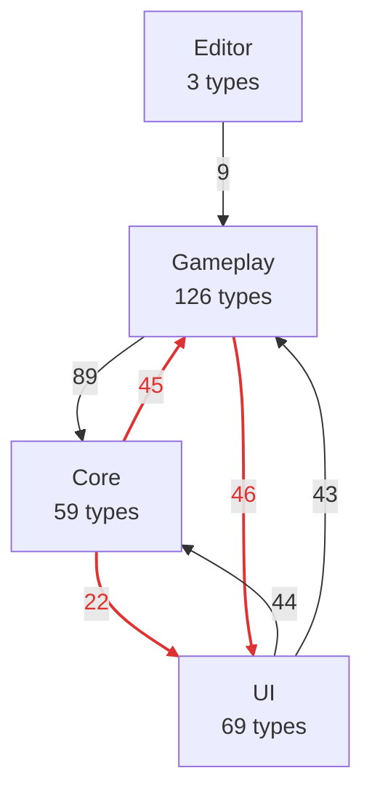

# Overview — layers & modules

[← index](README.md)

Intended direction: **Editor → UI → Gameplay → Core**. Red edges point the wrong way.

## Layer dependencies

Label = distinct type-to-type links.

## Module dependencies

Box = folder module (types · LOC). Edge label = distinct type pairs; edges under 3 pairs hidden.

```mermaid
flowchart LR
  subgraph L_Editor["Editor layer"]
    M_Editor["Editor<br/>3 types · 576 LOC"]
  end
  subgraph L_UI["UI layer"]
    M_UI["UI<br/>17 types · 732 LOC"]
    M_UI_Interactions["UI/Interactions<br/>2 types · 116 LOC"]
    M_UI_Inventory["UI/Inventory<br/>5 types · 584 LOC"]
    M_UI_Inventory_InventoryBin["UI/Inventory/InventoryBin<br/>1 types · 56 LOC"]
    M_UI_Inventory_InventoryBuy["UI/Inventory/InventoryBuy<br/>2 types · 70 LOC"]
    M_UI_Inventory_InventoryPlayer["UI/Inventory/InventoryPlayer<br/>2 types · 105 LOC"]
    M_UI_Items["UI/Items<br/>3 types · 83 LOC"]
    M_UI_LoadingSecne["UI/LoadingSecne<br/>6 types · 280 LOC"]
    M_UI_LoadingSecne_LoadingTextAnimation["UI/LoadingSecne/LoadingTextAnimation<br/>1 types · 19 LOC"]
    M_UI_LoadingSecne_LoadingVisualController["UI/LoadingSecne/LoadingVisualController<br/>3 types · 40 LOC"]
    M_UI_Money["UI/Money<br/>1 types · 41 LOC"]
    M_UI_Notifications["UI/Notifications<br/>7 types · 201 LOC"]
    M_UI_Ocean["UI/Ocean<br/>1 types · 73 LOC"]
    M_UI_QuestCompleteUI["UI/QuestCompleteUI<br/>1 types · 98 LOC"]
    M_UI_Shop["UI/Shop<br/>2 types · 403 LOC"]
    M_UI_UIManager["UI/UIManager<br/>4 types · 399 LOC"]
    M_UI_UIMenuSetting["UI/UIMenuSetting<br/>3 types · 137 LOC"]
    M_UI_Upgrads["UI/Upgrads<br/>6 types · 446 LOC"]
    M_UI_VFX["UI/VFX<br/>2 types · 148 LOC"]
  end
  subgraph L_Gameplay["Gameplay layer"]
    M_Gameplay_AudioSetting["Gameplay/AudioSetting<br/>7 types · 241 LOC"]
    M_Gameplay_Cutscenes["Gameplay/Cutscenes<br/>6 types · 312 LOC"]
    M_Gameplay_Entitys["Gameplay/Entitys<br/>6 types · 303 LOC"]
    M_Gameplay_Entitys_Enemys["Gameplay/Entitys/Enemys<br/>3 types · 173 LOC"]
    M_Gameplay_Entitys_Enemys_Beharviours["Gameplay/Entitys/Enemys/Beharviours<br/>1 types · 97 LOC"]
    M_Gameplay_Entitys_Enemys_Brain["Gameplay/Entitys/Enemys/Brain<br/>8 types · 363 LOC"]
    M_Gameplay_Entitys_Enemys_Brain_FSM["Gameplay/Entitys/Enemys/Brain/FSM<br/>3 types · 143 LOC"]
    M_Gameplay_Entitys_Enemys_Brain_FSM_States["Gameplay/Entitys/Enemys/Brain/FSM/States<br/>6 types · 712 LOC"]
    M_Gameplay_Entitys_Enemys_Brain_LinearPatrol["Gameplay/Entitys/Enemys/Brain/LinearPatrol<br/>5 types · 218 LOC"]
    M_Gameplay_Entitys_Enemys_NavAgents["Gameplay/Entitys/Enemys/NavAgents<br/>3 types · 162 LOC"]
    M_Gameplay_Entitys_Enemys_NavAgents_Core["Gameplay/Entitys/Enemys/NavAgents/Core<br/>5 types · 464 LOC"]
    M_Gameplay_Entitys_Enemys_Partbraked["Gameplay/Entitys/Enemys/Partbraked<br/>1 types · 19 LOC"]
    M_Gameplay_Entitys_NPCs["Gameplay/Entitys/NPCs<br/>2 types · 246 LOC"]
    M_Gameplay_Entitys_Players["Gameplay/Entitys/Players<br/>8 types · 925 LOC"]
    M_Gameplay_Entitys_Players_OxygenTube["Gameplay/Entitys/Players/OxygenTube<br/>3 types · 536 LOC"]
    M_Gameplay_Environments["Gameplay/Environments<br/>7 types · 480 LOC"]
    M_Gameplay_InteractObjects["Gameplay/InteractObjects<br/>7 types · 743 LOC"]
    M_Gameplay_MainCameras["Gameplay/MainCameras<br/>2 types · 40 LOC"]
    M_Gameplay_Projectiles["Gameplay/Projectiles<br/>5 types · 226 LOC"]
    M_Gameplay_QuestSystems_Quest["Gameplay/QuestSystems/Quest<br/>37 types · 1829 LOC"]
    M_Gameplay_RopeSystems["Gameplay/RopeSystems<br/>1 types · 49 LOC"]
  end
  subgraph L_Core["Core layer"]
    M_Core["Core<br/>7 types · 252 LOC"]
    M_Core_Datas["Core/Datas<br/>3 types · 19 LOC"]
    M_Core_Datas_ScriptableDatas_Characters["Core/Datas/ScriptableDatas/Characters<br/>2 types · 27 LOC"]
    M_Core_Datas_ScriptableDatas_Quests_QuestBoard["Core/Datas/ScriptableDatas/Quests/QuestBoard<br/>5 types · 408 LOC"]
    M_Core_Inputs["Core/Inputs<br/>1 types · 137 LOC"]
    M_Core_Inputs_KeyBind["Core/Inputs/KeyBind<br/>2 types · 350 LOC"]
    M_Core_Inputs_KeyBind_MovePlayerDirsction["Core/Inputs/KeyBind/MovePlayerDirsction<br/>1 types · 7 LOC"]
    M_Core_Inputs_KeyBind_SaveKeyBind["Core/Inputs/KeyBind/SaveKeyBind<br/>3 types · 28 LOC"]
    M_Core_Inputs_KeyBind_UIKeyBind["Core/Inputs/KeyBind/UIKeyBind<br/>3 types · 143 LOC"]
    M_Core_Interfaces["Core/Interfaces<br/>5 types · 30 LOC"]
    M_Core_Pool["Core/Pool<br/>2 types · 76 LOC"]
    M_Core_Save_Game["Core/Save Game<br/>11 types · 685 LOC"]
    M_Core_Save_Game_DayAndResetEnemys["Core/Save Game/DayAndResetEnemys<br/>11 types · 630 LOC"]
    M_Core_Services["Core/Services<br/>2 types · 170 LOC"]
    M_Core_VideoManager["Core/VideoManager<br/>1 types · 70 LOC"]
  end
  M_Core -->|3| M_Gameplay_QuestSystems_Quest
  M_Core -->|3| M_UI
  M_Core_Datas_ScriptableDatas_Quests_QuestBoard -->|14| M_Gameplay_QuestSystems_Quest
  M_Core_Inputs_KeyBind_UIKeyBind -->|3| M_Core_Inputs_KeyBind
  M_Core_Save_Game -->|7| M_Core
  M_Core_Save_Game -->|3| M_Core_Save_Game_DayAndResetEnemys
  M_Core_Save_Game_DayAndResetEnemys -->|3| M_Core
  M_Core_Save_Game_DayAndResetEnemys -->|3| M_Core_Pool
  M_Core_Save_Game_DayAndResetEnemys -->|4| M_Core_Save_Game
  M_Core_Save_Game_DayAndResetEnemys -->|4| M_Gameplay_QuestSystems_Quest
  M_Core_Save_Game_DayAndResetEnemys -->|3| M_UI_Items
  M_Core_Services -->|4| M_Core_Save_Game
  M_Core_Services -->|3| M_Gameplay_QuestSystems_Quest
  M_Editor -->|8| M_Gameplay_QuestSystems_Quest
  M_Gameplay_Cutscenes -->|4| M_Core
  M_Gameplay_Cutscenes -->|3| M_Gameplay_QuestSystems_Quest
  M_Gameplay_Cutscenes -->|3| M_UI
  M_Gameplay_Entitys_Enemys -->|3| M_Gameplay_Entitys
  M_Gameplay_Entitys_Enemys_Brain -->|5| M_Core_Interfaces
  M_Gameplay_Entitys_Enemys_Brain -->|6| M_Gameplay_Entitys_Enemys_Brain_FSM_States
  M_Gameplay_Entitys_Enemys_Brain -->|3| M_Gameplay_Entitys_Enemys_NavAgents_Core
  M_Gameplay_Entitys_Enemys_Brain_FSM_States -->|18| M_Gameplay_Entitys_Enemys_Brain
  M_Gameplay_Entitys_Enemys_Brain_FSM_States -->|18| M_Gameplay_Entitys_Enemys_Brain_FSM
  M_Gameplay_Entitys_Enemys_Brain_FSM_States -->|6| M_Gameplay_Entitys_Enemys_NavAgents_Core
  M_Gameplay_Entitys_Enemys_Brain_LinearPatrol -->|3| M_Core_Interfaces
  M_Gameplay_Entitys_Enemys_NavAgents -->|3| M_Gameplay_Entitys_Enemys_Brain
  M_Gameplay_Entitys_NPCs -->|7| M_Gameplay_QuestSystems_Quest
  M_Gameplay_Entitys_Players -->|6| M_Core
  M_Gameplay_Entitys_Players -->|3| M_Core_Datas
  M_Gameplay_Entitys_Players -->|3| M_Core_Services
  M_Gameplay_Entitys_Players -->|4| M_Gameplay_Entitys
  M_Gameplay_Entitys_Players -->|3| M_Gameplay_Entitys_Players_OxygenTube
  M_Gameplay_Entitys_Players -->|9| M_Gameplay_QuestSystems_Quest
  M_Gameplay_Entitys_Players -->|4| M_UI_Items
  M_Gameplay_Environments -->|3| M_Core
  M_Gameplay_Environments -->|4| M_Gameplay_AudioSetting
  M_Gameplay_Environments -->|6| M_Gameplay_QuestSystems_Quest
  M_Gameplay_InteractObjects -->|4| M_Core
  M_Gameplay_Projectiles -->|3| M_Gameplay_QuestSystems_Quest
  M_Gameplay_QuestSystems_Quest -->|13| M_Core
  M_Gameplay_QuestSystems_Quest -->|3| M_Core_Save_Game
  M_Gameplay_QuestSystems_Quest -->|9| M_Gameplay_Cutscenes
  M_Gameplay_QuestSystems_Quest -->|4| M_Gameplay_Environments
  M_Gameplay_QuestSystems_Quest -->|7| M_UI
  M_Gameplay_QuestSystems_Quest -->|3| M_UI_Inventory
  M_Gameplay_QuestSystems_Quest -->|3| M_UI_LoadingSecne
  M_Gameplay_QuestSystems_Quest -->|3| M_UI_Notifications
  M_UI -->|12| M_Core
  M_UI -->|3| M_Core_Save_Game
  M_UI -->|3| M_Core_Save_Game_DayAndResetEnemys
  M_UI -->|3| M_Gameplay_QuestSystems_Quest
  M_UI -->|3| M_UI_Notifications
  M_UI_Interactions -->|3| M_Core
  M_UI_Interactions -->|4| M_Gameplay_QuestSystems_Quest
  M_UI_Inventory -->|3| M_Core
  M_UI_Inventory -->|4| M_UI_Inventory_InventoryPlayer
  M_UI_Inventory -->|3| M_UI_Items
  M_UI_Shop -->|5| M_Gameplay_QuestSystems_Quest
  M_UI_Shop -->|3| M_UI
  M_UI_Shop -->|4| M_UI_Inventory_InventoryPlayer
  M_UI_Shop -->|3| M_UI_Items
  M_UI_UIManager -->|4| M_Gameplay_QuestSystems_Quest
  M_UI_UIManager -->|5| M_UI
  M_UI_Upgrads -->|3| M_Gameplay_QuestSystems_Quest
  linkStyle 0,1,2,9,10,12,16,33,43,44,45,46 stroke:#d33,stroke-width:2px
```

## Module table

| Module | Types | LOC | Diagram |
|---|---|---|---|
| Gameplay/QuestSystems/Quest | 37 | 1829 | [open](modules/Gameplay_QuestSystems_Quest.md) |
| Gameplay/Entitys/Players | 8 | 925 | [open](modules/Gameplay_Entitys_Players.md) |
| Gameplay/InteractObjects | 7 | 743 | [open](modules/Gameplay_InteractObjects.md) |
| UI | 17 | 732 | [open](modules/UI.md) |
| Gameplay/Entitys/Enemys/Brain/FSM/States | 6 | 712 | [open](modules/Gameplay_Entitys_Enemys_Brain_FSM_States.md) |
| Core/Save Game | 11 | 685 | [open](modules/Core_Save_Game.md) |
| Core/Save Game/DayAndResetEnemys | 11 | 630 | [open](modules/Core_Save_Game_DayAndResetEnemys.md) |
| UI/Inventory | 5 | 584 | [open](modules/UI_Inventory.md) |
| Editor | 3 | 576 | [open](modules/Editor.md) |
| Gameplay/Entitys/Players/OxygenTube | 3 | 536 | [open](modules/Gameplay_Entitys_Players_OxygenTube.md) |
| Gameplay/Environments | 7 | 480 | [open](modules/Gameplay_Environments.md) |
| Gameplay/Entitys/Enemys/NavAgents/Core | 5 | 464 | [open](modules/Gameplay_Entitys_Enemys_NavAgents_Core.md) |
| UI/Upgrads | 6 | 446 | [open](modules/UI_Upgrads.md) |
| Core/Datas/ScriptableDatas/Quests/QuestBoard | 5 | 408 | [open](modules/Core_Datas_ScriptableDatas_Quests_QuestBoard.md) |
| UI/Shop | 2 | 403 | [open](modules/UI_Shop.md) |
| UI/UIManager | 4 | 399 | [open](modules/UI_UIManager.md) |
| Gameplay/Entitys/Enemys/Brain | 8 | 363 | [open](modules/Gameplay_Entitys_Enemys_Brain.md) |
| Core/Inputs/KeyBind | 2 | 350 | [open](modules/Core_Inputs_KeyBind.md) |
| Gameplay/Cutscenes | 6 | 312 | [open](modules/Gameplay_Cutscenes.md) |
| Gameplay/Entitys | 6 | 303 | [open](modules/Gameplay_Entitys.md) |
| UI/LoadingSecne | 6 | 280 | [open](modules/UI_LoadingSecne.md) |
| Core | 7 | 252 | [open](modules/Core.md) |
| Gameplay/Entitys/NPCs | 2 | 246 | [open](modules/Gameplay_Entitys_NPCs.md) |
| Gameplay/AudioSetting | 7 | 241 | [open](modules/Gameplay_AudioSetting.md) |
| Gameplay/Projectiles | 5 | 226 | [open](modules/Gameplay_Projectiles.md) |
| Gameplay/Entitys/Enemys/Brain/LinearPatrol | 5 | 218 | [open](modules/Gameplay_Entitys_Enemys_Brain_LinearPatrol.md) |
| UI/Notifications | 7 | 201 | [open](modules/UI_Notifications.md) |
| Gameplay/Entitys/Enemys | 3 | 173 | [open](modules/Gameplay_Entitys_Enemys.md) |
| Core/Services | 2 | 170 | [open](modules/Core_Services.md) |
| Gameplay/Entitys/Enemys/NavAgents | 3 | 162 | [open](modules/Gameplay_Entitys_Enemys_NavAgents.md) |
| UI/VFX | 2 | 148 | [open](modules/UI_VFX.md) |
| Core/Inputs/KeyBind/UIKeyBind | 3 | 143 | [open](modules/Core_Inputs_KeyBind_UIKeyBind.md) |
| Gameplay/Entitys/Enemys/Brain/FSM | 3 | 143 | [open](modules/Gameplay_Entitys_Enemys_Brain_FSM.md) |
| Core/Inputs | 1 | 137 | [open](modules/Core_Inputs.md) |
| UI/UIMenuSetting | 3 | 137 | [open](modules/UI_UIMenuSetting.md) |
| UI/Interactions | 2 | 116 | [open](modules/UI_Interactions.md) |
| UI/Inventory/InventoryPlayer | 2 | 105 | [open](modules/UI_Inventory_InventoryPlayer.md) |
| UI/QuestCompleteUI | 1 | 98 | [open](modules/UI_QuestCompleteUI.md) |
| Gameplay/Entitys/Enemys/Beharviours | 1 | 97 | [open](modules/Gameplay_Entitys_Enemys_Beharviours.md) |
| UI/Items | 3 | 83 | [open](modules/UI_Items.md) |
| Core/Pool | 2 | 76 | [open](modules/Core_Pool.md) |
| UI/Ocean | 1 | 73 | [open](modules/UI_Ocean.md) |
| Core/VideoManager | 1 | 70 | [open](modules/Core_VideoManager.md) |
| UI/Inventory/InventoryBuy | 2 | 70 | [open](modules/UI_Inventory_InventoryBuy.md) |
| UI/Inventory/InventoryBin | 1 | 56 | [open](modules/UI_Inventory_InventoryBin.md) |
| Gameplay/RopeSystems | 1 | 49 | [open](modules/Gameplay_RopeSystems.md) |
| UI/Money | 1 | 41 | [open](modules/UI_Money.md) |
| Gameplay/MainCameras | 2 | 40 | [open](modules/Gameplay_MainCameras.md) |
| UI/LoadingSecne/LoadingVisualController | 3 | 40 | [open](modules/UI_LoadingSecne_LoadingVisualController.md) |
| Core/Interfaces | 5 | 30 | [open](modules/Core_Interfaces.md) |
| Core/Inputs/KeyBind/SaveKeyBind | 3 | 28 | [open](modules/Core_Inputs_KeyBind_SaveKeyBind.md) |
| Core/Datas/ScriptableDatas/Characters | 2 | 27 | [open](modules/Core_Datas_ScriptableDatas_Characters.md) |
| Core/Datas | 3 | 19 | [open](modules/Core_Datas.md) |
| Gameplay/Entitys/Enemys/Partbraked | 1 | 19 | [open](modules/Gameplay_Entitys_Enemys_Partbraked.md) |
| UI/LoadingSecne/LoadingTextAnimation | 1 | 19 | [open](modules/UI_LoadingSecne_LoadingTextAnimation.md) |
| Core/Inputs/KeyBind/MovePlayerDirsction | 1 | 7 | [open](modules/Core_Inputs_KeyBind_MovePlayerDirsction.md) |
