# Event flow

[← index](README.md)

76 `+=` subscriptions. Arrow = subscriber → publisher, label = event. UnityEvent/AddListener not included.

```mermaid
flowchart LR
  AmmoWheel[AmmoWheel] -->|OnAmmoSelected| InputReader[InputReader]
  CollectableItemBase[CollectableItemBase] -->|OnInteracted| InputReader[InputReader]
  Cutscene[Cutscene] -->|OnSkipCutscene| InputReader[InputReader]
  CutsceneManager[CutsceneManager] -->|OnLoadingFinished| LoadingManager[LoadingManager]
  CutsceneManager[CutsceneManager] -->|OnQuestUpdated| QuestManager[QuestManager]
  CutsceneSkipHint[CutsceneSkipHint] -->|OnPlayingChanged| CutsceneGate[CutsceneGate]
  DoorInteract[DoorInteract] -->|OnQuestUpdated| QuestManager[QuestManager]
  EnemyKillTracker[EnemyKillTracker] -->|OnEnemyReset| DayManager[DayManager]
  Entity[Entity] -->|OnDamaged, OnDied| IEntityHealth[IEntityHealth]
  ExploreAreaTrigger[ExploreAreaTrigger] -->|OnQuestUpdated| QuestManager[QuestManager]
  GameHUD[GameHUD] -->|OnDayAdvanced| DayManager[DayManager]
  GameHUD[GameHUD] -->|OnMenuToggled| InputReader[InputReader]
  GameHUD[GameHUD] -->|OnLockChanged| PlayerUIState[PlayerUIState]
  GameObjectSpawnManager[GameObjectSpawnManager] -->|OnDayAdvanced, OnEnemyReset| DayManager[DayManager]
  InputReader[InputReader] -->|OnInitialized| KeyBindManager[KeyBindManager]
  InteractUI[InteractUI] -->|OnInteracted| InputReader[InputReader]
  InventoryManager[InventoryManager] -->|OnInventoryToggled| InputReader[InputReader]
  InventoryManager[InventoryManager] -->|OnLevelGranted, OnLevelsLoaded| UpgradeService[UpgradeService]
  ItemSpawner[ItemSpawner] -->|OnFeatureUnlocked| FeatureUnlockService[FeatureUnlockService]
  KeyBindUI[KeyBindUI] -->|OnBindingsChanged| KeyBindManager[KeyBindManager]
  LandUI[LandUI] -->|OnDayAdvanced, OnDivedToday| DayManager[DayManager]
  LandUI[LandUI] -->|OnChanged| DialogueState[DialogueState]
  LandUI[LandUI] -->|OnFeatureUnlocked| FeatureUnlockService[FeatureUnlockService]
  LandUI[LandUI] -->|OnLoadingFinished| LoadingManager[LoadingManager]
  MoveKeyBindUI[MoveKeyBindUI] -->|OnBindingsChanged| KeyBindManager[KeyBindManager]
  NPC[NPC] -->|PlayerExited| InteractUI[InteractUI]
  NPC[NPC] -->|OnQuestUpdated| QuestManager[QuestManager]
  NextDayAnimationUI[NextDayAnimationUI] -->|OnDayAdvanced| DayManager[DayManager]
  NotificationView[NotificationView] -->|OnClear, OnNotify| NotificationManager[NotificationManager]
  Player[Player] -->|OnAttacked, OnInteracted, OnSprinted, OnTeleport, OnUseItem| InputReader[InputReader]
  PlayerFeedbackVFX[PlayerFeedbackVFX] -->|OnPlayerDamaged| Player[Player]
  PlayerHealth[PlayerHealth] -->|OnLevelGranted| UpgradeService[UpgradeService]
  PlayerInteriorState[PlayerInteriorState] -->|OnActionPerformed| TutorialEvents[TutorialEvents]
  PlayerMoney[PlayerMoney] -->|OnMoneyRewarded| QuestManager[QuestManager]
  PlayerSelfDialogueUI[PlayerSelfDialogueUI] -->|OnInteracted| InputReader[InputReader]
  PlayerSelfDialogueUI[PlayerSelfDialogueUI] -->|OnLoadingFinished| LoadingManager[LoadingManager]
  PlayerSelfDialogueUI[PlayerSelfDialogueUI] -->|OnQuestUpdated| QuestManager[QuestManager]
  QuestBoardUI[QuestBoardUI] -->|OnQuestUpdated| QuestManager[QuestManager]
  QuestCompleteUI[QuestCompleteUI] -->|OnQuestCompleted| QuestManager[QuestManager]
  QuestManager[QuestManager] -->|OnCutsceneFinished| CutsceneEvents[CutsceneEvents]
  QuestManager[QuestManager] -->|OnDayAdvanced, OnDivedToday| DayManager[DayManager]
  QuestManager[QuestManager] -->|OnChanged| DialogueState[DialogueState]
  QuestManager[QuestManager] -->|OnEnemyKilled| EnemyEvents[EnemyEvents]
  QuestManager[QuestManager] -->|OnAreaReached| ExploreEvents[ExploreEvents]
  QuestManager[QuestManager] -->|OnNpcTalkedTo| NpcEvents[NpcEvents]
  QuestManager[QuestManager] -->|OnMoneyChanged| PlayerMoney[PlayerMoney]
  QuestManager[QuestManager] -->|OnActionPerformed| TutorialEvents[TutorialEvents]
  QuestTrackerUI[QuestTrackerUI] -->|OnQuestUpdated| QuestManager[QuestManager]
  ResourceNotificationPresenter[ResourceNotificationPresenter] -->|OnItemDelta| InventoryManager[InventoryManager]
  ResourceNotificationPresenter[ResourceNotificationPresenter] -->|OnMoneyDelta| PlayerMoney[PlayerMoney]
  ReviceQuestListUI[ReviceQuestListUI] -->|OnQuestUpdated| QuestManager[QuestManager]
  RopeBreakCountdownUI[RopeBreakCountdownUI] -->|OnRopeBreachEnd, OnRopeBreachStart| OxygenRope[OxygenRope]
  SaveBridge[SaveBridge] -->|OnDayAdvanced| DayManager[DayManager]
  SaveNotificationUI[SaveNotificationUI] -->|OnSaved| SaveBridge[SaveBridge]
  ShelleController[ShelleController] -->|OnCollected| ItemDrop[ItemDrop]
  ShopManager[ShopManager] -->|OnShopSlotClicked| InventorySlot[InventorySlot]
  ShopManager[ShopManager] -->|OnQuestUpdated| QuestManager[QuestManager]
  TrashInteract[TrashInteract] -->|OnDayAdvanced| DayManager[DayManager]
  TutorialActionMarker[TutorialActionMarker] -->|OnQuestUpdated| QuestManager[QuestManager]
  TutorialPromptUI[TutorialPromptUI] -->|OnLoadingFinished| LoadingManager[LoadingManager]
  TutorialPromptUI[TutorialPromptUI] -->|OnLockChanged| PlayerUIState[PlayerUIState]
  TutorialPromptUI[TutorialPromptUI] -->|OnQuestUpdated| QuestManager[QuestManager]
  TutorialUIMarker[TutorialUIMarker] -->|OnQuestUpdated| QuestManager[QuestManager]
  UIManager[UIManager] -->|OnReturningToMenu| GameManager[GameManager]
  UpgradeSlot[UpgradeSlot] -->|OnQuestUpdated| QuestManager[QuestManager]
```

## Event catalogue

| Publisher | Event | Subscribers |
|---|---|---|
| CutsceneEvents | OnCutsceneFinished | QuestManager |
| CutsceneGate | OnPlayingChanged | CutsceneSkipHint |
| DayManager | OnDayAdvanced | GameHUD, GameObjectSpawnManager, LandUI, NextDayAnimationUI, QuestManager, SaveBridge, TrashInteract |
| DayManager | OnDivedToday | LandUI, QuestManager |
| DayManager | OnEnemyReset | EnemyKillTracker, GameObjectSpawnManager |
| DialogueState | OnChanged | LandUI, QuestManager |
| EnemyEvents | OnEnemyKilled | QuestManager |
| ExploreEvents | OnAreaReached | QuestManager |
| FeatureUnlockService | OnFeatureUnlocked | ItemSpawner, LandUI |
| GameManager | OnReturningToMenu | UIManager |
| IEntityHealth | OnDamaged | Entity |
| IEntityHealth | OnDied | Entity |
| InputReader | OnAmmoSelected | AmmoWheel |
| InputReader | OnAttacked | Player |
| InputReader | OnInteracted | CollectableItemBase, InteractUI, Player, PlayerSelfDialogueUI |
| InputReader | OnInventoryToggled | InventoryManager |
| InputReader | OnMenuToggled | GameHUD |
| InputReader | OnSkipCutscene | Cutscene |
| InputReader | OnSprinted | Player |
| InputReader | OnTeleport | Player |
| InputReader | OnUseItem | Player |
| InteractUI | PlayerExited | NPC |
| InventoryManager | OnItemDelta | ResourceNotificationPresenter |
| InventorySlot | OnShopSlotClicked | ShopManager |
| ItemDrop | OnCollected | ShelleController |
| KeyBindManager | OnBindingsChanged | KeyBindUI, MoveKeyBindUI |
| KeyBindManager | OnInitialized | InputReader |
| LoadingManager | OnLoadingFinished | CutsceneManager, LandUI, PlayerSelfDialogueUI, TutorialPromptUI |
| NotificationManager | OnClear | NotificationView |
| NotificationManager | OnNotify | NotificationView |
| NpcEvents | OnNpcTalkedTo | QuestManager |
| OxygenRope | OnRopeBreachEnd | RopeBreakCountdownUI |
| OxygenRope | OnRopeBreachStart | RopeBreakCountdownUI |
| Player | OnPlayerDamaged | PlayerFeedbackVFX |
| PlayerMoney | OnMoneyChanged | QuestManager |
| PlayerMoney | OnMoneyDelta | ResourceNotificationPresenter |
| PlayerUIState | OnLockChanged | GameHUD, TutorialPromptUI |
| QuestManager | OnMoneyRewarded | PlayerMoney |
| QuestManager | OnQuestCompleted | QuestCompleteUI |
| QuestManager | OnQuestUpdated | CutsceneManager, DoorInteract, ExploreAreaTrigger, NPC, PlayerSelfDialogueUI, QuestBoardUI, QuestTrackerUI, ReviceQuestListUI, ShopManager, TutorialActionMarker, TutorialPromptUI, TutorialUIMarker, UpgradeSlot |
| SaveBridge | OnSaved | SaveNotificationUI |
| TutorialEvents | OnActionPerformed | PlayerInteriorState, QuestManager |
| UpgradeService | OnLevelGranted | InventoryManager, PlayerHealth |
| UpgradeService | OnLevelsLoaded | InventoryManager |

## Declared events with no `+=` subscriber found

May be wired via lambdas on another name, inspector, or genuinely unused.

EntityHealth.OnDamaged, EntityHealth.OnDied, FeatureUnlockService.OnFeatureLocked, InputReader.OnAimed, InputReader.OnMoved
