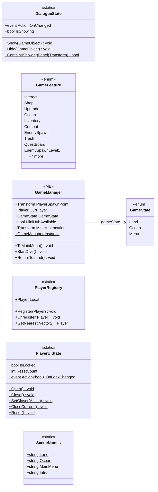

# Core

7 types · 252 LOC (non-blank) · depends on: [Gameplay/QuestSystems/Quest](Gameplay_QuestSystems_Quest.md) ×3, [UI](UI.md) ×3, [Gameplay/Entitys/Players](Gameplay_Entitys_Players.md) ×2, [Core/Inputs](Core_Inputs.md) ×1, [UI/UIManager](UI_UIManager.md) ×1, [UI/LoadingSecne](UI_LoadingSecne.md) ×1, [Core/Services](Core_Services.md) ×1, [UI/LoadingSecne/LoadingVisualController](UI_LoadingSecne_LoadingVisualController.md) ×1, [Core/Save Game/DayAndResetEnemys](Core_Save_Game_DayAndResetEnemys.md) ×1, [Core/Save Game](Core_Save_Game.md) ×1

[← index](../README.md)

## Files

| Type | Kind | File | LOC |
|---|---|---|---|
| DialogueState | static | `DialogueState.cs:13` | 36 |
| GameFeature | enum | `GameFeature.cs:7` | 20 |
| GameManager | MB | `GameManager.cs:13` | 126 |
| GameState | enum | `GameManager.cs:6` | 6 |
| PlayerRegistry | static | `PlayerRegistry.cs:5` | 18 |
| PlayerUIState | static | `PlayerUIState.cs:12` | 39 |
| SceneNames | static | `SceneNames.cs:7` | 7 |
