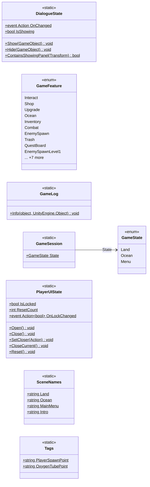

# Core

8 types · 123 LOC (non-blank) · depends on: none

[← index](../README.md)

## Files

| Type | Kind | File | LOC |
|---|---|---|---|
| DialogueState | static | `DialogueState.cs:13` | 36 |
| GameFeature | enum | `GameFeature.cs:7` | 20 |
| GameLog | static | `GameLog.cs:6` | 6 |
| GameSession | static | `GameSession.cs:4` | 4 |
| GameState | enum | `GameState.cs:3` | 6 |
| PlayerUIState | static | `PlayerUIState.cs:12` | 39 |
| SceneNames | static | `SceneNames.cs:7` | 7 |
| Tags | static | `Tags.cs:4` | 5 |
