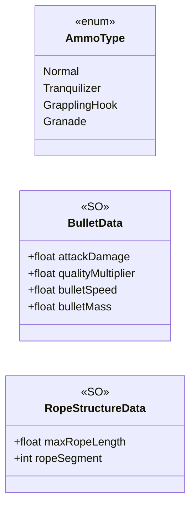

# Core/Data

3 types · 19 LOC (non-blank) · depends on: none

[← index](../README.md)

## Files

| Type | Kind | File | LOC |
|---|---|---|---|
| AmmoType | enum | `BulletData.cs:5` | 7 |
| BulletData | SO | `BulletData.cs:14` | 7 |
| RopeStructureData | SO | `RopeStructureData.cs:6` | 5 |
