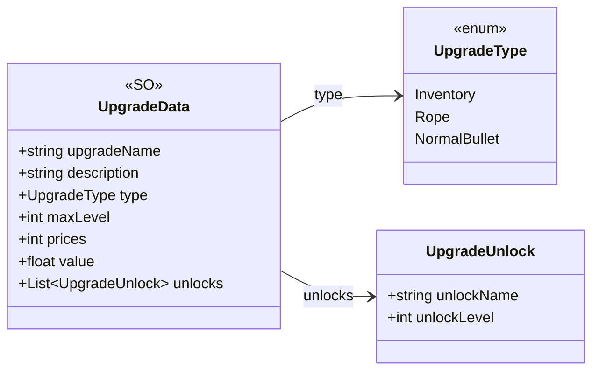

# Core/Data/Upgrades

3 types · 31 LOC (non-blank) · depends on: none

[← index](../README.md)

## Files

| Type | Kind | File | LOC |
|---|---|---|---|
| UpgradeData | SO | `UpgradeData.cs:25` | 18 |
| UpgradeType | enum | `UpgradeData.cs:7` | 6 |
| UpgradeUnlock | class | `UpgradeData.cs:15` | 7 |
