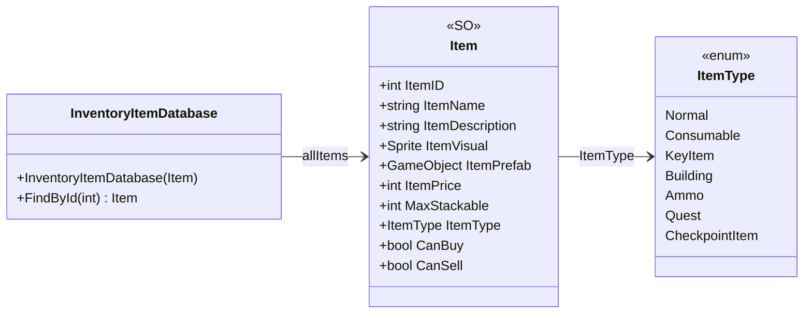

# Core/Datas/Items

3 types · 50 LOC (non-blank) · depends on: none

[← index](../README.md)

## Files

| Type | Kind | File | LOC |
|---|---|---|---|
| InventoryItemDatabase | class | `InventoryItemDatabase.cs:3` | 18 |
| Item | SO | `Item.cs:6` | 22 |
| ItemType | enum | `Item.cs:36` | 10 |
