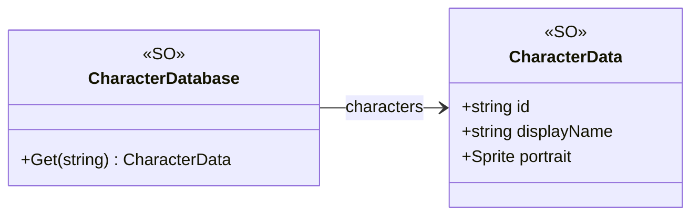

# Core/Datas/ScriptableDatas/Characters

2 types · 27 LOC (non-blank) · depends on: none

[← index](../README.md)

## Files

| Type | Kind | File | LOC |
|---|---|---|---|
| CharacterData | SO | `CharacterData.cs:11` | 8 |
| CharacterDatabase | SO | `CharacterDatabase.cs:9` | 19 |
