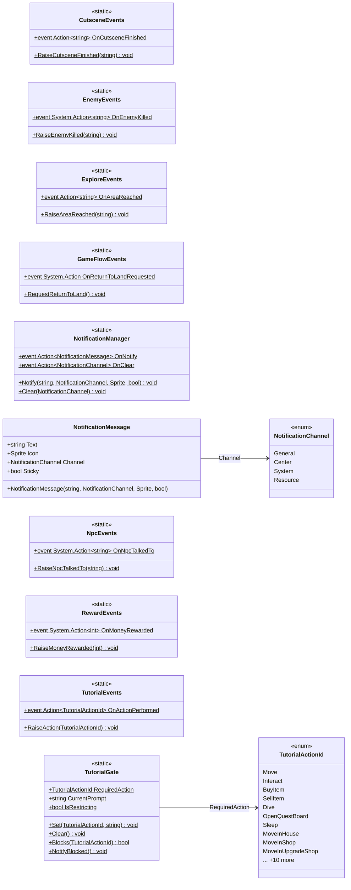

# Core/Events

12 types · 138 LOC (non-blank) · depends on: none

[← index](../README.md)

## Files

| Type | Kind | File | LOC |
|---|---|---|---|
| CutsceneEvents | static | `CutsceneEvents.cs:6` | 8 |
| EnemyEvents | static | `EnemyEvents.cs:3` | 8 |
| ExploreEvents | static | `ExploreEvents.cs:5` | 8 |
| GameFlowEvents | static | `GameFlowEvents.cs:4` | 5 |
| NotificationChannel | enum | `NotificationChannel.cs:5` | 7 |
| NotificationManager | static | `NotificationManager.cs:7` | 12 |
| NotificationMessage | class | `NotificationMessage.cs:6` | 14 |
| NpcEvents | static | `NpcEvents.cs:4` | 8 |
| RewardEvents | static | `RewardEvents.cs:4` | 5 |
| TutorialActionId | enum | `TutorialEvents.cs:6` | 23 |
| TutorialEvents | static | `TutorialEvents.cs:36` | 8 |
| TutorialGate | static | `TutorialGate.cs:9` | 32 |
