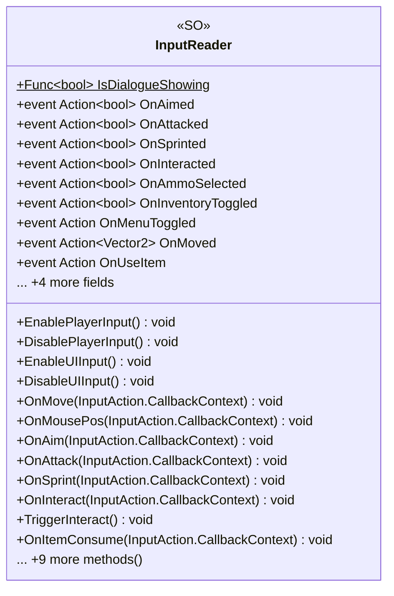

# Core/Inputs

1 types · 137 LOC (non-blank) · depends on: [Core/Inputs/KeyBind](Core_Inputs_KeyBind.md) ×1

[← index](../README.md)

## Event subscriptions

| Subscriber | Publisher | Event |
|---|---|---|
| InputReader | KeyBindManager | OnInitialized |

## Files

| Type | Kind | File | LOC |
|---|---|---|---|
| InputReader | SO | `InputReader.cs:9` | 137 |
