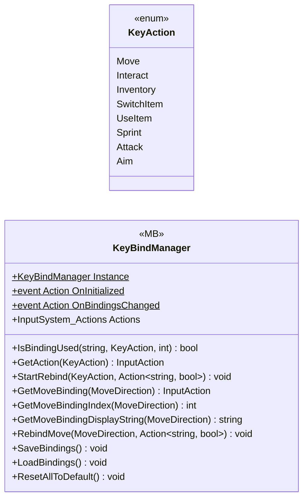

# Core/Inputs/KeyBind

2 types · 350 LOC (non-blank) · depends on: [Core/Inputs/KeyBind/SaveKeyBind](Core_Inputs_KeyBind_SaveKeyBind.md) ×2, [Core/Inputs/KeyBind/MovePlayerDirsction](Core_Inputs_KeyBind_MovePlayerDirsction.md) ×1, [Gameplay/Entitys/Players](Gameplay_Entitys_Players.md) ×1

[← index](../README.md)

## Files

| Type | Kind | File | LOC |
|---|---|---|---|
| KeyAction | enum | `KeyAction.cs:5` | 11 |
| KeyBindManager | MB | `KeyBindManager.cs:8` | 339 |
