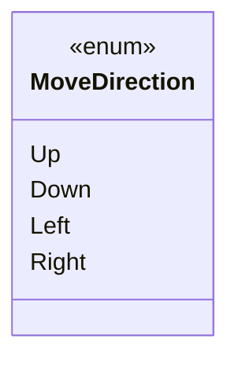

# Core/Inputs/KeyBind/MoveDirection

1 types · 7 LOC (non-blank) · depends on: none

[← index](../README.md)

## Files

| Type | Kind | File | LOC |
|---|---|---|---|
| MoveDirection | enum | `MoveDirection.cs:3` | 7 |
