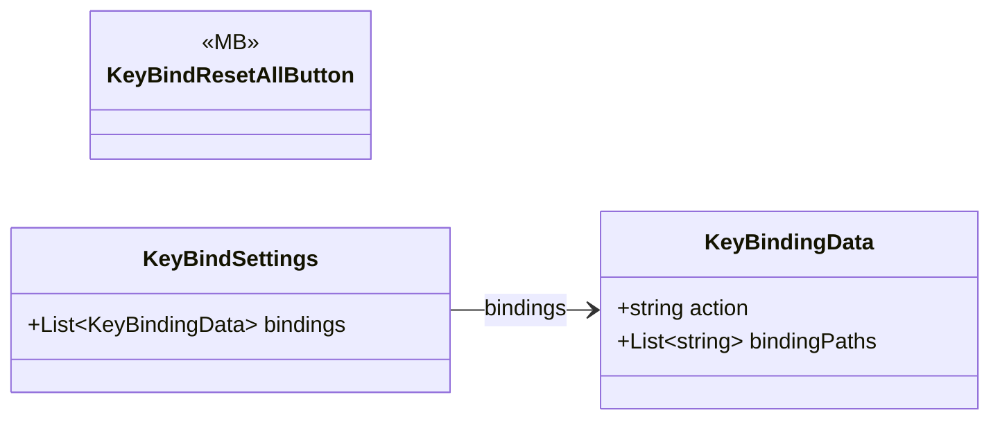

# Core/Inputs/KeyBind/SaveKeyBind

3 types · 28 LOC (non-blank) · depends on: [Core/Inputs/KeyBind](Core_Inputs_KeyBind.md) ×1

[← index](../README.md)

## Files

| Type | Kind | File | LOC |
|---|---|---|---|
| KeyBindResetAllButton | MB | `KeyBindResetAllButton.cs:6` | 19 |
| KeyBindSettings | class | `KeyBindSettings.cs:7` | 4 |
| KeyBindingData | class | `KeyBindSettings.cs:13` | 5 |
