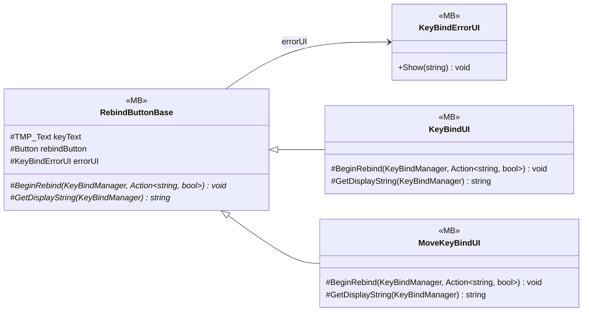

# Core/Inputs/KeyBind/UIKeyBind

4 types · 94 LOC (non-blank) · depends on: [Core/Inputs/KeyBind](Core_Inputs_KeyBind.md) ×4, [Core/Inputs/KeyBind/MoveDirection](Core_Inputs_KeyBind_MoveDirection.md) ×1

[← index](../README.md)

## Event subscriptions

| Subscriber | Publisher | Event |
|---|---|---|
| RebindButtonBase | KeyBindManager | OnBindingsChanged |

## Files

| Type | Kind | File | LOC |
|---|---|---|---|
| KeyBindErrorUI | MB | `KeyBindErrorUI.cs:7` | 26 |
| KeyBindUI | MB | `KeyBindUI.cs:7` | 13 |
| MoveKeyBindUI | MB | `MoveKeyBindUI.cs:6` | 9 |
| RebindButtonBase | MB, abstract | `RebindButtonBase.cs:9` | 46 |
