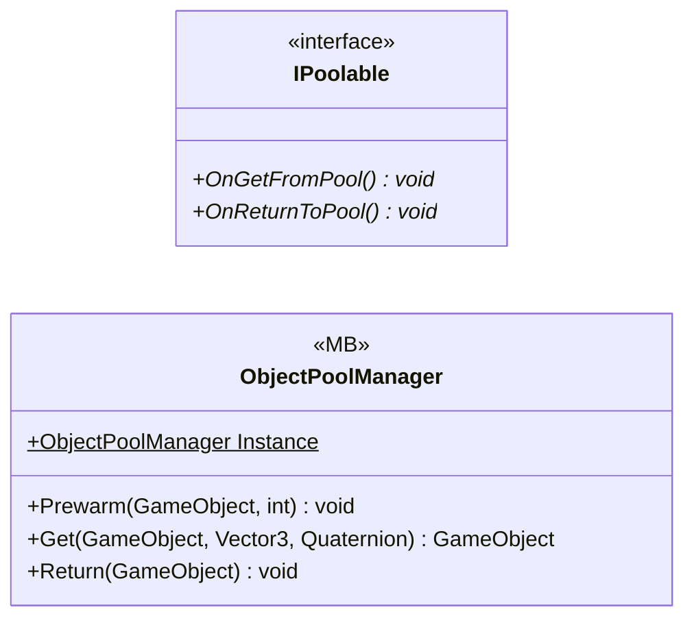

# Core/Pool

2 types · 76 LOC (non-blank) · depends on: none

[← index](../README.md)

## Files

| Type | Kind | File | LOC |
|---|---|---|---|
| IPoolable | interface | `IPoolable.cs:5` | 5 |
| ObjectPoolManager | MB | `ObjectPoolManager.cs:7` | 71 |
