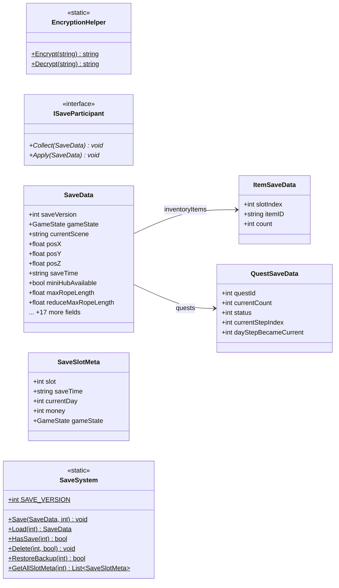

# Core/Save

7 types · 246 LOC (non-blank) · depends on: [Core](Core.md) ×2

[← index](../README.md)

## Files

| Type | Kind | File | LOC |
|---|---|---|---|
| EncryptionHelper | static | `EncryptionHelper.cs:8` | 41 |
| ISaveParticipant | interface | `ISaveParticipant.cs:9` | 5 |
| ItemSaveData | class | `SaveData.cs:61` | 6 |
| QuestSaveData | class | `SaveData.cs:69` | 8 |
| SaveData | class | `SaveData.cs:7` | 28 |
| SaveSlotMeta | class | `SaveSystem.cs:14` | 8 |
| SaveSystem | static | `SaveSystem.cs:23` | 150 |
