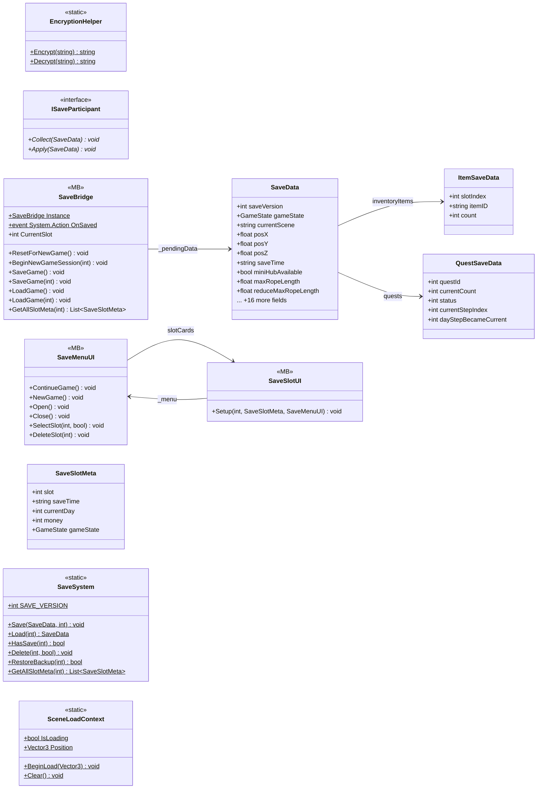

# Core/Save

11 types · 685 LOC (non-blank) · depends on: [Core](Core.md) ×7, [Core/Save/DayReset](Core_Save_DayReset.md) ×3, [Gameplay/QuestSystems/Quest](Gameplay_QuestSystems_Quest.md) ×2, [Gameplay/Entities/Players](Gameplay_Entities_Players.md) ×2, [Core/Services](Core_Services.md) ×2, [UI/Loading](UI_Loading.md) ×2, [UI](UI.md) ×2, [UI/Loading/LoadingVisualController](UI_Loading_LoadingVisualController.md) ×1, [UI/Inventory](UI_Inventory.md) ×1, [UI/Inventory/InventoryPlayer](UI_Inventory_InventoryPlayer.md) ×1, [Gameplay/Cutscenes](Gameplay_Cutscenes.md) ×1

[← index](../README.md)

## Event subscriptions

| Subscriber | Publisher | Event |
|---|---|---|
| SaveBridge | DayManager | OnDayAdvanced |

## Files

| Type | Kind | File | LOC |
|---|---|---|---|
| EncryptionHelper | static | `EncryptionHelper.cs:8` | 41 |
| ISaveParticipant | interface | `ISaveParticipant.cs:9` | 5 |
| ItemSaveData | class | `SaveData.cs:59` | 6 |
| QuestSaveData | class | `SaveData.cs:67` | 8 |
| SaveBridge | MB | `SaveBridge.cs:8` | 288 |
| SaveData | class | `SaveData.cs:7` | 27 |
| SaveMenuUI | MB | `SaveMenuUI.cs:6` | 102 |
| SaveSlotMeta | class | `SaveSystem.cs:14` | 8 |
| SaveSlotUI | MB | `SaveSlotUI.cs:12` | 39 |
| SaveSystem | static | `SaveSystem.cs:23` | 150 |
| SceneLoadContext | static | `SceneLoadContext.cs:20` | 11 |
