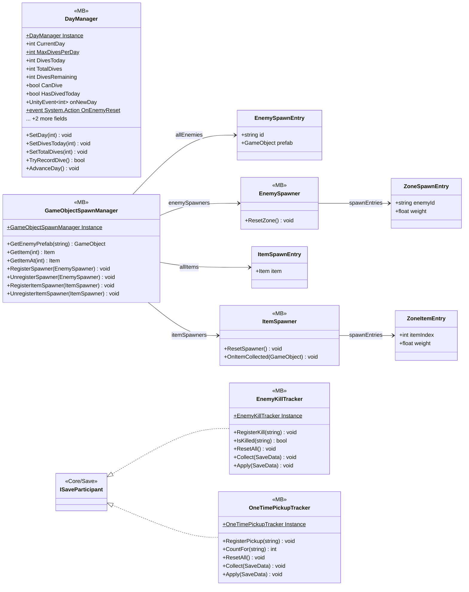

# Core/Save/DayReset

10 types · 572 LOC (non-blank) · depends on: [Core/Save](Core_Save.md) ×4, [Core/Pool](Core_Pool.md) ×3, [Core](Core.md) ×3, [UI/Items](UI_Items.md) ×3, [Gameplay/QuestSystems/Quest](Gameplay_QuestSystems_Quest.md) ×2, [Core/Services](Core_Services.md) ×2, [Gameplay/Entities/Enemies/Behaviours](Gameplay_Entities_Enemies_Behaviours.md) ×1, [Gameplay/Entities/Enemies/NavAgents/Core](Gameplay_Entities_Enemies_NavAgents_Core.md) ×1, [Gameplay/Entities/Enemies/NavAgents](Gameplay_Entities_Enemies_NavAgents.md) ×1

[← index](../README.md)

## Event subscriptions

| Subscriber | Publisher | Event |
|---|---|---|
| EnemyKillTracker | DayManager | OnEnemyReset |
| GameObjectSpawnManager | DayManager | OnDayAdvanced |
| GameObjectSpawnManager | DayManager | OnEnemyReset |
| ItemSpawner | FeatureUnlockService | OnFeatureUnlocked |

## Files

| Type | Kind | File | LOC |
|---|---|---|---|
| DayManager | MB | `DayManager.cs:6` | 46 |
| EnemyKillTracker | MB | `EnemyKillTracker.cs:10` | 28 |
| EnemySpawnEntry | class | `GameObjectSpawnManager.cs:10` | 6 |
| EnemySpawner | MB | `EnemySpawner.cs:21` | 209 |
| GameObjectSpawnManager | MB | `GameObjectSpawnManager.cs:26` | 112 |
| ItemSpawnEntry | class | `GameObjectSpawnManager.cs:18` | 5 |
| ItemSpawner | MB | `ItemSpawner.cs:20` | 132 |
| OneTimePickupTracker | MB | `OneTimePickupTracker.cs:9` | 20 |
| ZoneItemEntry | class | `ItemSpawner.cs:8` | 7 |
| ZoneSpawnEntry | class | `EnemySpawner.cs:10` | 7 |
