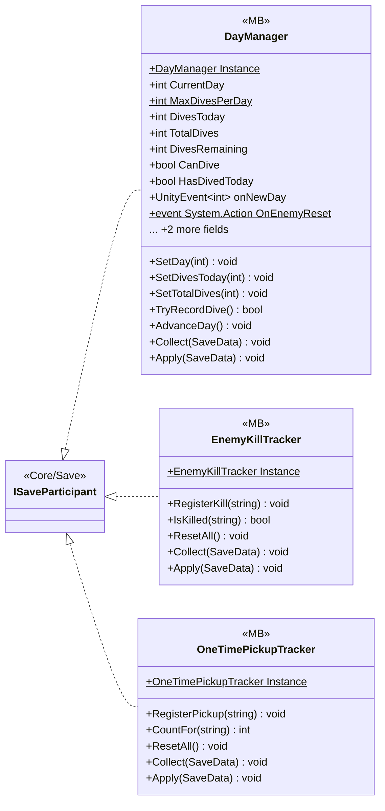

# Core/Save/DayReset

3 types · 107 LOC (non-blank) · depends on: [Core/Save](Core_Save.md) ×6, [Core/Events](Core_Events.md) ×2, [Core](Core.md) ×1

[← index](../README.md)

## Event subscriptions

| Subscriber | Publisher | Event |
|---|---|---|
| EnemyKillTracker | DayManager | OnEnemyReset |

## Files

| Type | Kind | File | LOC |
|---|---|---|---|
| DayManager | MB | `DayManager.cs:6` | 59 |
| EnemyKillTracker | MB | `EnemyKillTracker.cs:10` | 28 |
| OneTimePickupTracker | MB | `OneTimePickupTracker.cs:9` | 20 |
