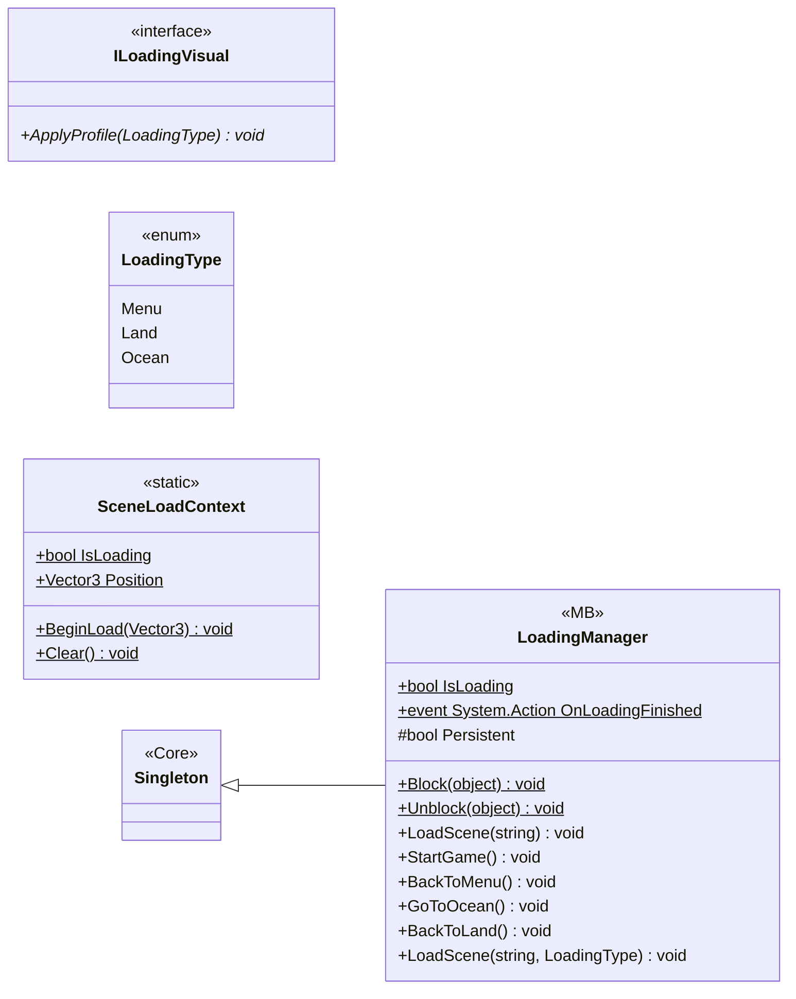

# Core/Scenes

4 types · 159 LOC (non-blank) · depends on: [Core](Core.md) ×1

[← index](../README.md)

## Files

| Type | Kind | File | LOC |
|---|---|---|---|
| ILoadingVisual | interface | `ILoadingVisual.cs:4` | 4 |
| LoadingManager | MB | `LoadingManager.cs:9` | 138 |
| LoadingType | enum | `LoadingType.cs:3` | 6 |
| SceneLoadContext | static | `SceneLoadContext.cs:20` | 11 |
