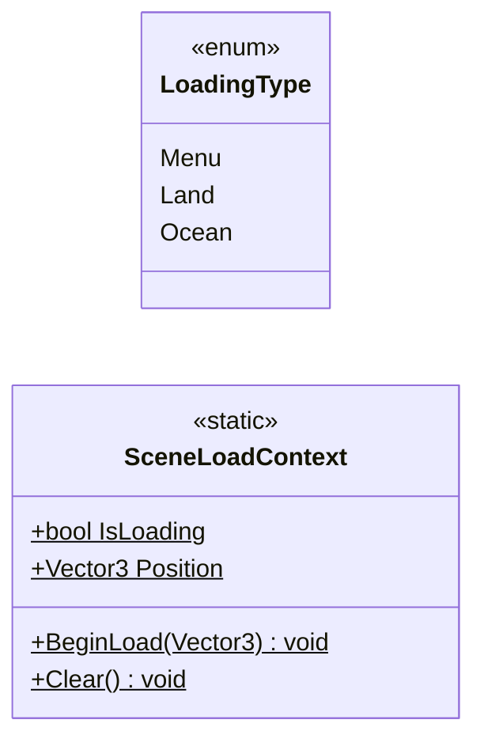

# Core/Scenes

2 types · 17 LOC (non-blank) · depends on: none

[← index](../README.md)

## Files

| Type | Kind | File | LOC |
|---|---|---|---|
| LoadingType | enum | `LoadingType.cs:3` | 6 |
| SceneLoadContext | static | `SceneLoadContext.cs:20` | 11 |
