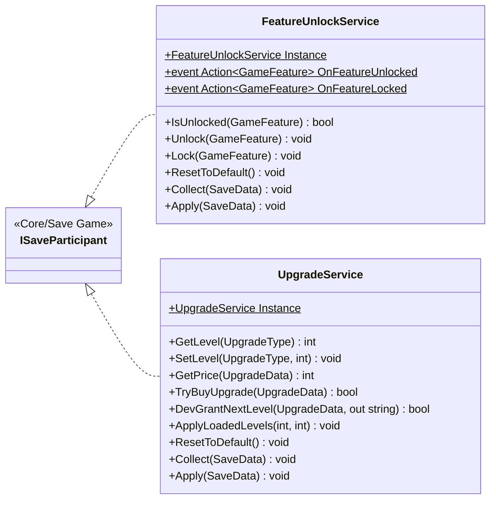

# Core/Services

2 types · 170 LOC (non-blank) · depends on: [Core/Save Game](Core_Save_Game.md) ×4, [Gameplay/QuestSystems/Quest](Gameplay_QuestSystems_Quest.md) ×3, [Core](Core.md) ×2, [UI/Upgrads](UI_Upgrads.md) ×2, [Gameplay/Entitys/Players](Gameplay_Entitys_Players.md) ×2, [Gameplay/Projectiles](Gameplay_Projectiles.md) ×1, [UI](UI.md) ×1, [UI/Inventory](UI_Inventory.md) ×1, [Gameplay/Entitys/Players/OxygenTube](Gameplay_Entitys_Players_OxygenTube.md) ×1

[← index](../README.md)

## Files

| Type | Kind | File | LOC |
|---|---|---|---|
| FeatureUnlockService | class | `FeatureUnlockService.cs:16` | 66 |
| UpgradeService | class | `UpgradeService.cs:12` | 104 |
