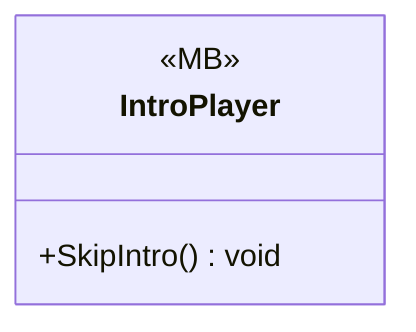

# Core/VideoManager

1 types · 70 LOC (non-blank) · depends on: [UI/LoadingSecne](UI_LoadingSecne.md) ×1, [UI/LoadingSecne/LoadingVisualController](UI_LoadingSecne_LoadingVisualController.md) ×1

[← index](../README.md)

## Files

| Type | Kind | File | LOC |
|---|---|---|---|
| IntroPlayer | MB | `IntroPlayer.cs:13` | 70 |
