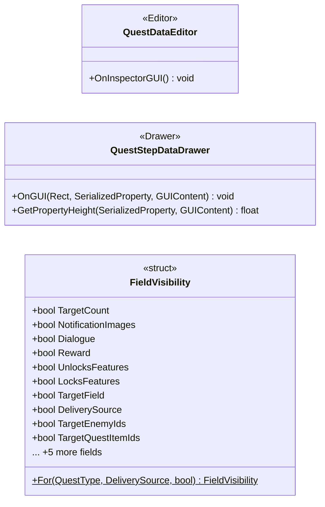

# Editor

3 types · 576 LOC (non-blank) · depends on: [Gameplay/QuestSystems/Quest](Gameplay_QuestSystems_Quest.md) ×6

[← index](../README.md)

## Files

| Type | Kind | File | LOC |
|---|---|---|---|
| FieldVisibility | struct | `QuestStepDataDrawer.cs:72` | 31 |
| QuestDataEditor | Editor | `QuestDataEditor.cs:19` | 48 |
| QuestStepDataDrawer | Drawer | `QuestStepDataDrawer.cs:67` | 528 |
