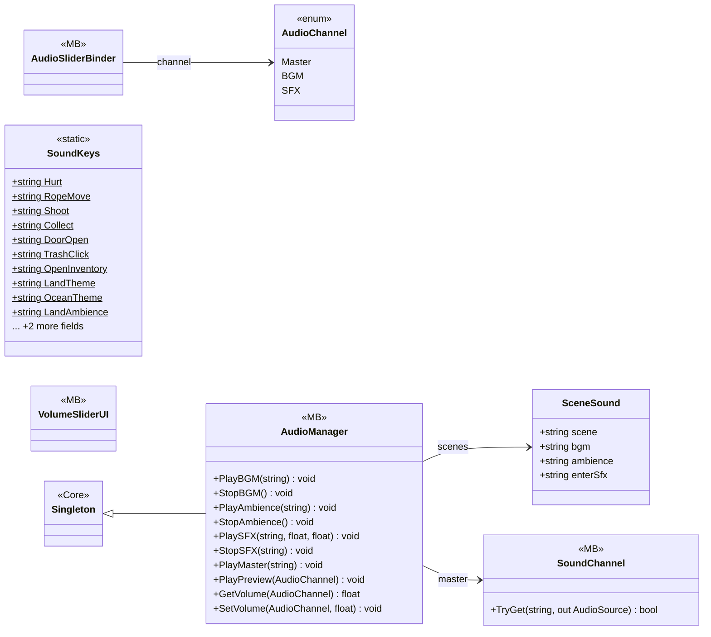

# Gameplay/AudioSetting

7 types · 226 LOC (non-blank) · depends on: [Core](Core.md) ×1

[← index](../README.md)

## Files

| Type | Kind | File | LOC |
|---|---|---|---|
| AudioChannel | enum | `AudioManager.cs:8` | 6 |
| AudioManager | MB | `AudioManager.cs:28` | 135 |
| AudioSliderBinder | MB | `AudioSliderBinder.cs:9` | 19 |
| SceneSound | class | `AudioManager.cs:18` | 7 |
| SoundChannel | MB | `SoundChannel.cs:8` | 25 |
| SoundKeys | static | `SoundKeys.cs:6` | 15 |
| VolumeSliderUI | MB | `VolumeSliderUI.cs:8` | 19 |
