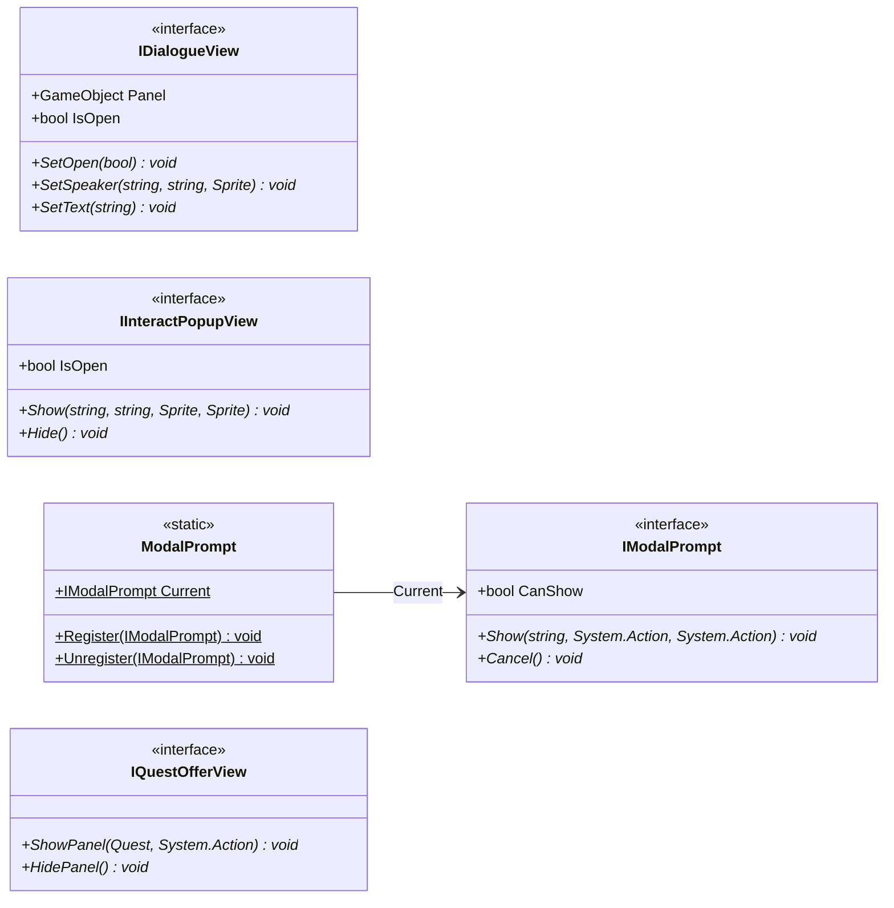

# Gameplay/Contracts

5 types · 34 LOC (non-blank) · depends on: [Gameplay/QuestSystems/Quest](Gameplay_QuestSystems_Quest.md) ×1

[← index](../README.md)

## Files

| Type | Kind | File | LOC |
|---|---|---|---|
| IDialogueView | interface | `IDialogueView.cs:7` | 8 |
| IInteractPopupView | interface | `IInteractPopupView.cs:6` | 6 |
| IModalPrompt | interface | `IModalPrompt.cs:6` | 6 |
| IQuestOfferView | interface | `IQuestOfferView.cs:6` | 5 |
| ModalPrompt | static | `IModalPrompt.cs:14` | 9 |
