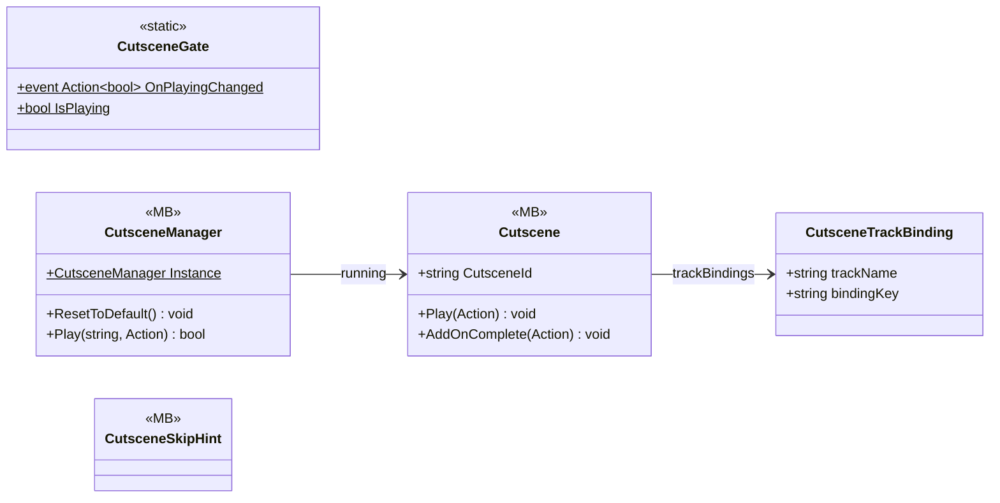

# Gameplay/Cutscenes

5 types · 304 LOC (non-blank) · depends on: [Core](Core.md) ×3, [Gameplay/QuestSystems/Quest](Gameplay_QuestSystems_Quest.md) ×3, [Core/Events](Core_Events.md) ×3, [Core/Inputs](Core_Inputs.md) ×1, [Gameplay/Game](Gameplay_Game.md) ×1, [Gameplay/Environments](Gameplay_Environments.md) ×1, [Gameplay/Contracts](Gameplay_Contracts.md) ×1, [Core/Scenes](Core_Scenes.md) ×1

[← index](../README.md)

## Event subscriptions

| Subscriber | Publisher | Event |
|---|---|---|
| Cutscene | InputReader | OnSkipCutscene |
| CutsceneManager | LoadingManager | OnLoadingFinished |
| CutsceneManager | QuestManager | OnQuestUpdated |
| CutsceneSkipHint | CutsceneGate | OnPlayingChanged |

## Files

| Type | Kind | File | LOC |
|---|---|---|---|
| Cutscene | MB | `Cutscene.cs:43` | 135 |
| CutsceneGate | static | `CutsceneGate.cs:12` | 15 |
| CutsceneManager | MB | `CutsceneManager.cs:22` | 132 |
| CutsceneSkipHint | MB | `CutsceneSkipHint.cs:7` | 15 |
| CutsceneTrackBinding | class | `Cutscene.cs:23` | 7 |
