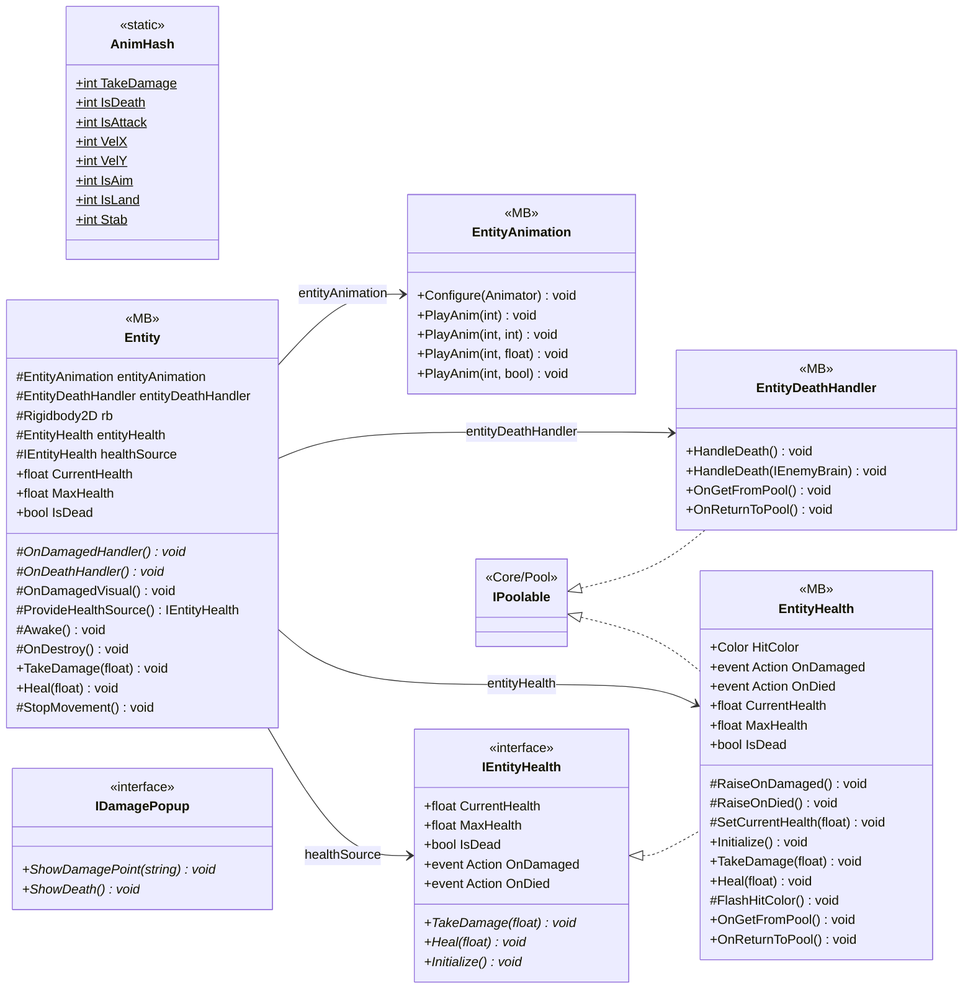

# Gameplay/Entities

7 types · 322 LOC (non-blank) · depends on: [Core/Pool](Core_Pool.md) ×2, [Gameplay/Entities/Enemies/Brain/Interfaces](Gameplay_Entities_Enemies_Brain_Interfaces.md) ×1, [Gameplay/Entities/Enemies/Behaviours](Gameplay_Entities_Enemies_Behaviours.md) ×1, [Gameplay/Entities/Enemies/NavAgents/Core](Gameplay_Entities_Enemies_NavAgents_Core.md) ×1

[← index](../README.md)

## Event subscriptions

| Subscriber | Publisher | Event |
|---|---|---|
| Entity | IEntityHealth | OnDamaged |
| Entity | IEntityHealth | OnDied |

## Files

| Type | Kind | File | LOC |
|---|---|---|---|
| AnimHash | static | `AnimHash.cs:11` | 11 |
| Entity | MB, abstract | `Entity.cs:7` | 78 |
| EntityAnimation | MB | `EntityAnimation.cs:6` | 50 |
| EntityDeathHandler | MB | `EntityDeathHandler.cs:7` | 93 |
| EntityHealth | MB | `EntityHealth.cs:9` | 74 |
| IDamagePopup | interface | `IDamagePopup.cs:6` | 5 |
| IEntityHealth | interface | `IEntityHealth.cs:6` | 11 |
