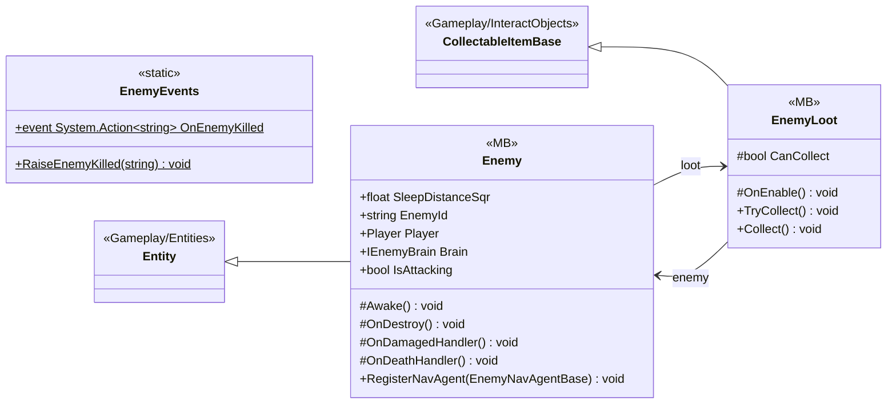

# Gameplay/Entities/Enemies

3 types · 173 LOC (non-blank) · depends on: [Gameplay/Entities](Gameplay_Entities.md) ×3, [Core](Core.md) ×2, [Core/Pool](Core_Pool.md) ×2, [Core/Interfaces](Core_Interfaces.md) ×2, [Gameplay/AudioSetting](Gameplay_AudioSetting.md) ×2, [Gameplay/Entities/Enemies/NavAgents/Core](Gameplay_Entities_Enemies_NavAgents_Core.md) ×1, [Gameplay/Entities/Players](Gameplay_Entities_Players.md) ×1, [UI/Inventory](UI_Inventory.md) ×1, [Gameplay/InteractObjects](Gameplay_InteractObjects.md) ×1, [UI/Items](UI_Items.md) ×1

[← index](../README.md)

## Files

| Type | Kind | File | LOC |
|---|---|---|---|
| Enemy | MB | `Enemy.cs:17` | 124 |
| EnemyEvents | static | `Enemy.cs:6` | 8 |
| EnemyLoot | MB | `EnemyLoot.cs:6` | 41 |
