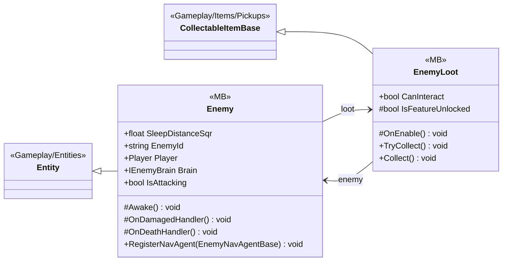

# Gameplay/Entities/Enemies

2 types · 150 LOC (non-blank) · depends on: [Gameplay/Entities](Gameplay_Entities.md) ×3, [Gameplay/Entities/Players](Gameplay_Entities_Players.md) ×3, [Core/Pool](Core_Pool.md) ×2, [Gameplay/AudioSetting](Gameplay_AudioSetting.md) ×2, [Gameplay/Entities/Enemies/Brain/Interfaces](Gameplay_Entities_Enemies_Brain_Interfaces.md) ×2, [Core](Core.md) ×1, [Core/Data/Items](Core_Data_Items.md) ×1, [Core/Events](Core_Events.md) ×1, [Gameplay/Entities/Enemies/NavAgents/Core](Gameplay_Entities_Enemies_NavAgents_Core.md) ×1, [Gameplay/Inventory](Gameplay_Inventory.md) ×1, [Gameplay/Items/Pickups](Gameplay_Items_Pickups.md) ×1

[← index](../README.md)

## Files

| Type | Kind | File | LOC |
|---|---|---|---|
| Enemy | MB | `Enemy.cs:7` | 108 |
| EnemyLoot | MB | `EnemyLoot.cs:6` | 42 |
