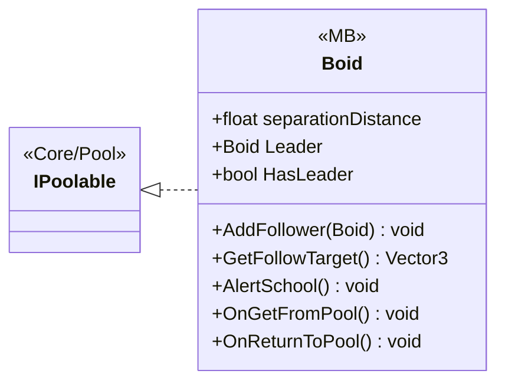

# Gameplay/Entities/Enemies/Behaviours

1 types · 97 LOC (non-blank) · depends on: [Core/Pool](Core_Pool.md) ×1, [Gameplay/Entities/Enemies/Brain/Interfaces](Gameplay_Entities_Enemies_Brain_Interfaces.md) ×1, [Gameplay/Entities/Enemies/NavAgents/Core](Gameplay_Entities_Enemies_NavAgents_Core.md) ×1

[← index](../README.md)

## Files

| Type | Kind | File | LOC |
|---|---|---|---|
| Boid | MB | `Boid.cs:12` | 97 |
