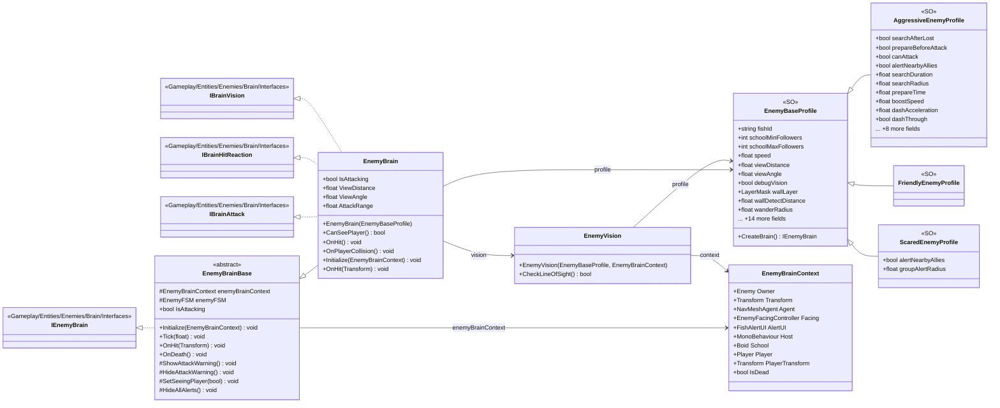

# Gameplay/Entities/Enemies/Brain

8 types · 363 LOC (non-blank) · depends on: [Gameplay/Entities/Enemies/Brain/FSM/States](Gameplay_Entities_Enemies_Brain_FSM_States.md) ×6, [Gameplay/Entities/Enemies/Brain/Interfaces](Gameplay_Entities_Enemies_Brain_Interfaces.md) ×5, [Gameplay/Entities/Enemies/NavAgents/Core](Gameplay_Entities_Enemies_NavAgents_Core.md) ×3, [Gameplay/Entities/Enemies/Brain/FSM](Gameplay_Entities_Enemies_Brain_FSM.md) ×2, [Gameplay/Entities/Enemies/PartBreak](Gameplay_Entities_Enemies_PartBreak.md) ×1, [Gameplay/Entities/Enemies](Gameplay_Entities_Enemies.md) ×1, [Gameplay/Entities/Enemies/NavAgents](Gameplay_Entities_Enemies_NavAgents.md) ×1, [Gameplay/Entities/Enemies/Behaviours](Gameplay_Entities_Enemies_Behaviours.md) ×1, [Gameplay/Entities/Players](Gameplay_Entities_Players.md) ×1

[← index](../README.md)

## Files

| Type | Kind | File | LOC |
|---|---|---|---|
| AggressiveEnemyProfile | SO | `AggressiveEnemyProfile.cs:11` | 44 |
| EnemyBaseProfile | SO, abstract | `EnemyBaseProfile.cs:10` | 64 |
| EnemyBrain | class | `EnemyBrain.cs:6` | 134 |
| EnemyBrainBase | abstract | `EnemyBrainBase.cs:6` | 42 |
| EnemyBrainContext | class | `EnemyBrainContext.cs:10` | 13 |
| EnemyVision | class | `EnemyVision.cs:6` | 54 |
| FriendlyEnemyProfile | SO | `FriendlyEnemyProfile.cs:13` | 3 |
| ScaredEnemyProfile | SO | `ScaredEnemyProfile.cs:14` | 9 |
