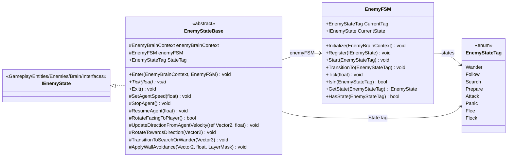

# Gameplay/Entities/Enemies/Brain/FSM

3 types · 143 LOC (non-blank) · depends on: [Gameplay/Entities/Enemies/Brain/Interfaces](Gameplay_Entities_Enemies_Brain_Interfaces.md) ×2, [Gameplay/Entities/Enemies/Brain](Gameplay_Entities_Enemies_Brain.md) ×2, [Gameplay/Entities/Enemies/Brain/FSM/States](Gameplay_Entities_Enemies_Brain_FSM_States.md) ×1

[← index](../README.md)

## Files

| Type | Kind | File | LOC |
|---|---|---|---|
| EnemyFSM | class | `EnemyFSM.cs:7` | 50 |
| EnemyStateBase | abstract | `EnemyStateBase.cs:10` | 82 |
| EnemyStateTag | enum | `EnemyStateTag.cs:10` | 11 |
