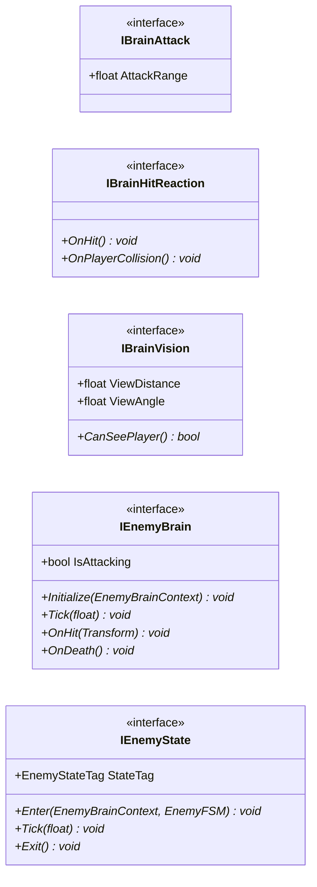

# Gameplay/Entities/Enemies/Brain/Interfaces

5 types · 30 LOC (non-blank) · depends on: [Gameplay/Entities/Enemies/Brain](Gameplay_Entities_Enemies_Brain.md) ×2, [Gameplay/Entities/Enemies/Brain/FSM](Gameplay_Entities_Enemies_Brain_FSM.md) ×2

[← index](../README.md)

## Files

| Type | Kind | File | LOC |
|---|---|---|---|
| IBrainAttack | interface | `IBrainAttack.cs:5` | 4 |
| IBrainHitReaction | interface | `IBrainHitReaction.cs:6` | 5 |
| IBrainVision | interface | `IBrainVision.cs:7` | 6 |
| IEnemyBrain | interface | `IEnemyBrain.cs:6` | 8 |
| IEnemyState | interface | `IEnemyState.cs:7` | 7 |
