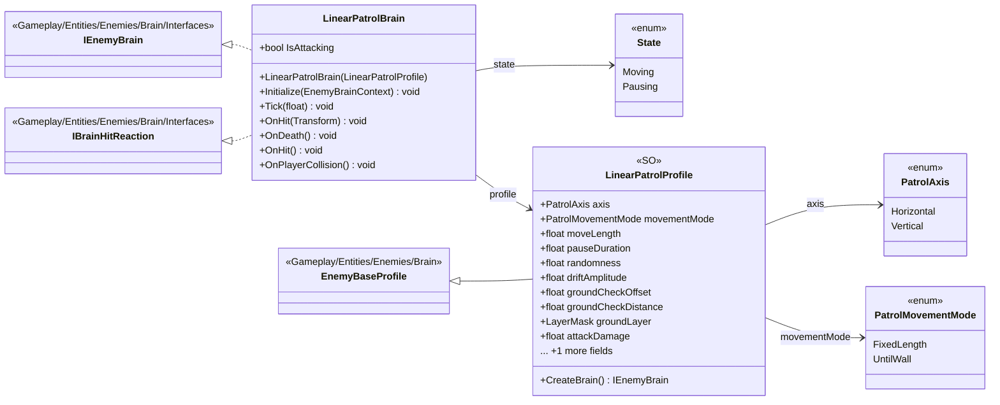

# Gameplay/Entities/Enemies/Brain/LinearPatrol

5 types · 218 LOC (non-blank) · depends on: [Gameplay/Entities/Enemies/Brain/Interfaces](Gameplay_Entities_Enemies_Brain_Interfaces.md) ×3, [Gameplay/Entities/Enemies/Brain](Gameplay_Entities_Enemies_Brain.md) ×2, [Gameplay/Entities/Enemies/PartBreak](Gameplay_Entities_Enemies_PartBreak.md) ×1

[← index](../README.md)

## Files

| Type | Kind | File | LOC |
|---|---|---|---|
| LinearPatrolBrain | class | `LinearPatrolBrain.cs:6` | 179 |
| LinearPatrolProfile | SO | `LinearPatrolProfile.cs:17` | 30 |
| PatrolAxis | enum | `LinearPatrolProfile.cs:6` | 5 |
| PatrolMovementMode | enum | `LinearPatrolProfile.cs:11` | 4 |
| State | enum | `LinearPatrolBrain.cs:7` | 1 |
