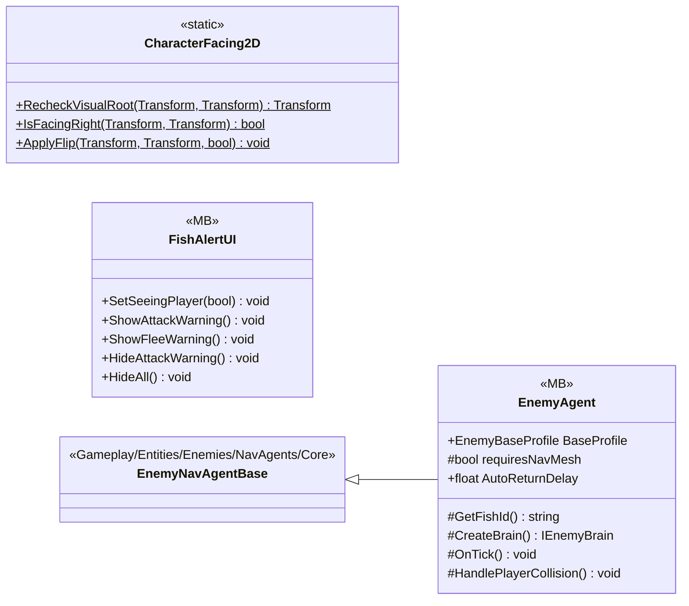

# Gameplay/Entities/Enemies/NavAgents

3 types · 162 LOC (non-blank) · depends on: [Gameplay/Entities/Enemies/Brain](Gameplay_Entities_Enemies_Brain.md) ×3, [Gameplay/Entities/Enemies/Brain/Interfaces](Gameplay_Entities_Enemies_Brain_Interfaces.md) ×2, [Gameplay/Entities/Enemies/NavAgents/Core](Gameplay_Entities_Enemies_NavAgents_Core.md) ×1

[← index](../README.md)

## Files

| Type | Kind | File | LOC |
|---|---|---|---|
| CharacterFacing2D | static | `CharacterFacing2D.cs:9` | 33 |
| EnemyAgent | MB | `EnemyAgent.cs:6` | 28 |
| FishAlertUI | MB | `FishAlertUI.cs:7` | 101 |
