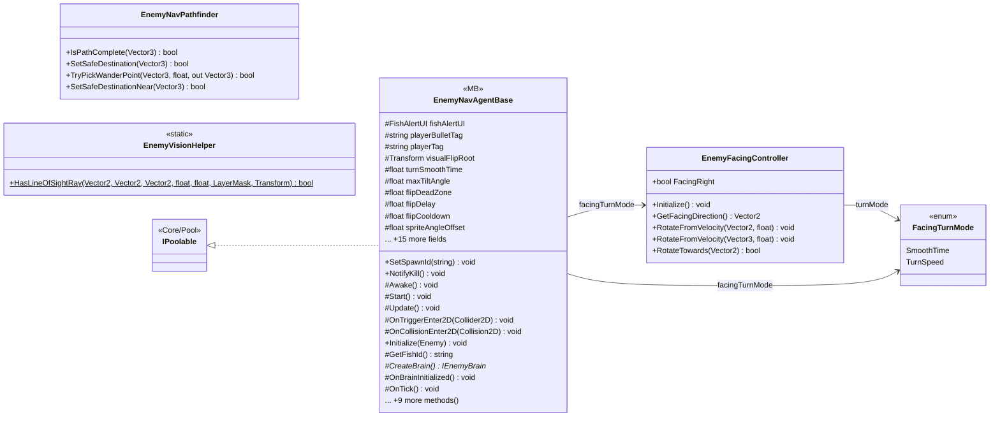

# Gameplay/Entities/Enemies/NavAgents/Core

5 types · 478 LOC (non-blank) · depends on: [Gameplay/Entities/Enemies/NavAgents](Gameplay_Entities_Enemies_NavAgents.md) ×2, [Gameplay/Entities/Players](Gameplay_Entities_Players.md) ×2, [Core](Core.md) ×1, [Core/Pool](Core_Pool.md) ×1, [Core/Save/DayReset](Core_Save_DayReset.md) ×1, [Gameplay/Entities/Enemies](Gameplay_Entities_Enemies.md) ×1, [Gameplay/Entities/Enemies/Behaviours](Gameplay_Entities_Enemies_Behaviours.md) ×1, [Gameplay/Entities/Enemies/Brain](Gameplay_Entities_Enemies_Brain.md) ×1, [Gameplay/Entities/Enemies/Brain/Interfaces](Gameplay_Entities_Enemies_Brain_Interfaces.md) ×1

[← index](../README.md)

## Files

| Type | Kind | File | LOC |
|---|---|---|---|
| EnemyFacingController | class | `EnemyFacingController.cs:7` | 109 |
| EnemyNavAgentBase | MB, abstract | `EnemyNavAgentBase.cs:7` | 242 |
| EnemyNavPathfinder | class | `EnemyNavPathfinder.cs:8` | 106 |
| EnemyVisionHelper | static | `EnemyVisionHelper.cs:6` | 21 |
| FacingTurnMode | enum | `EnemyFacingController.cs:33` | 5 |
