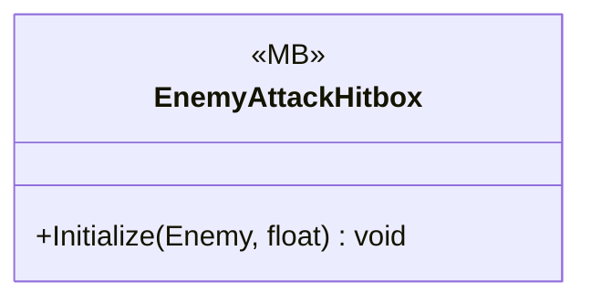

# Gameplay/Entities/Enemies/PartBreak

1 types · 19 LOC (non-blank) · depends on: [Gameplay/Entities/Enemies](Gameplay_Entities_Enemies.md) ×1, [Gameplay/Entities/Players](Gameplay_Entities_Players.md) ×1

[← index](../README.md)

## Files

| Type | Kind | File | LOC |
|---|---|---|---|
| EnemyAttackHitbox | MB | `EnemyAttackHitbox.cs:5` | 19 |
