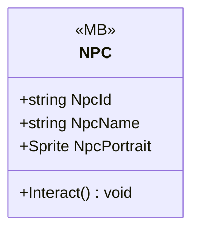

# Gameplay/Entities/NPCs

1 types · 243 LOC (non-blank) · depends on: [Gameplay/QuestSystems/Quest](Gameplay_QuestSystems_Quest.md) ×7, [Gameplay/Cutscenes](Gameplay_Cutscenes.md) ×2, [Gameplay/Contracts](Gameplay_Contracts.md) ×2, [Gameplay/Environments](Gameplay_Environments.md) ×1, [Core/Events](Core_Events.md) ×1, [Gameplay/Interaction](Gameplay_Interaction.md) ×1, [Gameplay/Game](Gameplay_Game.md) ×1, [Core/Scenes](Core_Scenes.md) ×1, [Core](Core.md) ×1

[← index](../README.md)

## Event subscriptions

| Subscriber | Publisher | Event |
|---|---|---|
| NPC | InteractUI | PlayerExited |
| NPC | QuestManager | OnQuestUpdated |

## Files

| Type | Kind | File | LOC |
|---|---|---|---|
| NPC | MB | `NPC.cs:6` | 243 |
