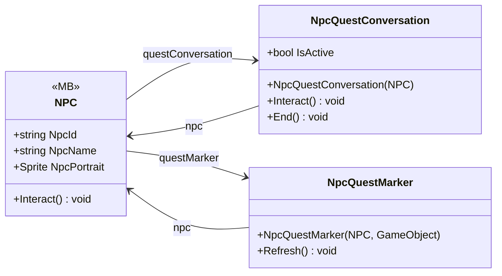

# Gameplay/Entities/NPCs

3 types · 259 LOC (non-blank) · depends on: [Gameplay/QuestSystems/Quest](Gameplay_QuestSystems_Quest.md) ×11, [Gameplay/Contracts](Gameplay_Contracts.md) ×2, [Gameplay/Cutscenes](Gameplay_Cutscenes.md) ×2, [Gameplay/Interaction](Gameplay_Interaction.md) ×2, [Core](Core.md) ×1, [Core/Events](Core_Events.md) ×1, [Core/Scenes](Core_Scenes.md) ×1, [Gameplay/Environments](Gameplay_Environments.md) ×1

[← index](../README.md)

## Event subscriptions

| Subscriber | Publisher | Event |
|---|---|---|
| NPC | Interactable | PlayerExited |
| NPC | QuestManager | OnQuestUpdated |

## Files

| Type | Kind | File | LOC |
|---|---|---|---|
| NPC | MB | `NPC.cs:6` | 146 |
| NpcQuestConversation | class | `NpcQuestConversation.cs:7` | 84 |
| NpcQuestMarker | class | `NpcQuestMarker.cs:7` | 29 |
