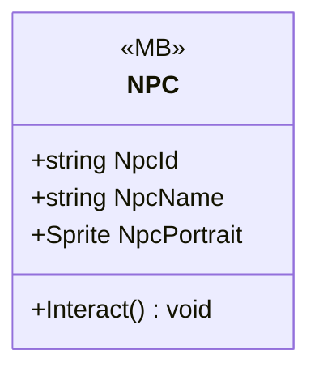

# Gameplay/Entities/NPCs

1 types · 238 LOC (non-blank) · depends on: [Gameplay/QuestSystems/Quest](Gameplay_QuestSystems_Quest.md) ×7, [Gameplay/Cutscenes](Gameplay_Cutscenes.md) ×2, [Core](Core.md) ×2, [Gameplay/Environments](Gameplay_Environments.md) ×1, [UI/Interactions](UI_Interactions.md) ×1, [Core/Events](Core_Events.md) ×1, [UI/Loading](UI_Loading.md) ×1, [UI/Quest](UI_Quest.md) ×1, [UI](UI.md) ×1

[← index](../README.md)

## Event subscriptions

| Subscriber | Publisher | Event |
|---|---|---|
| NPC | InteractUI | PlayerExited |
| NPC | QuestManager | OnQuestUpdated |

## Files

| Type | Kind | File | LOC |
|---|---|---|---|
| NPC | MB | `NPC.cs:7` | 238 |
