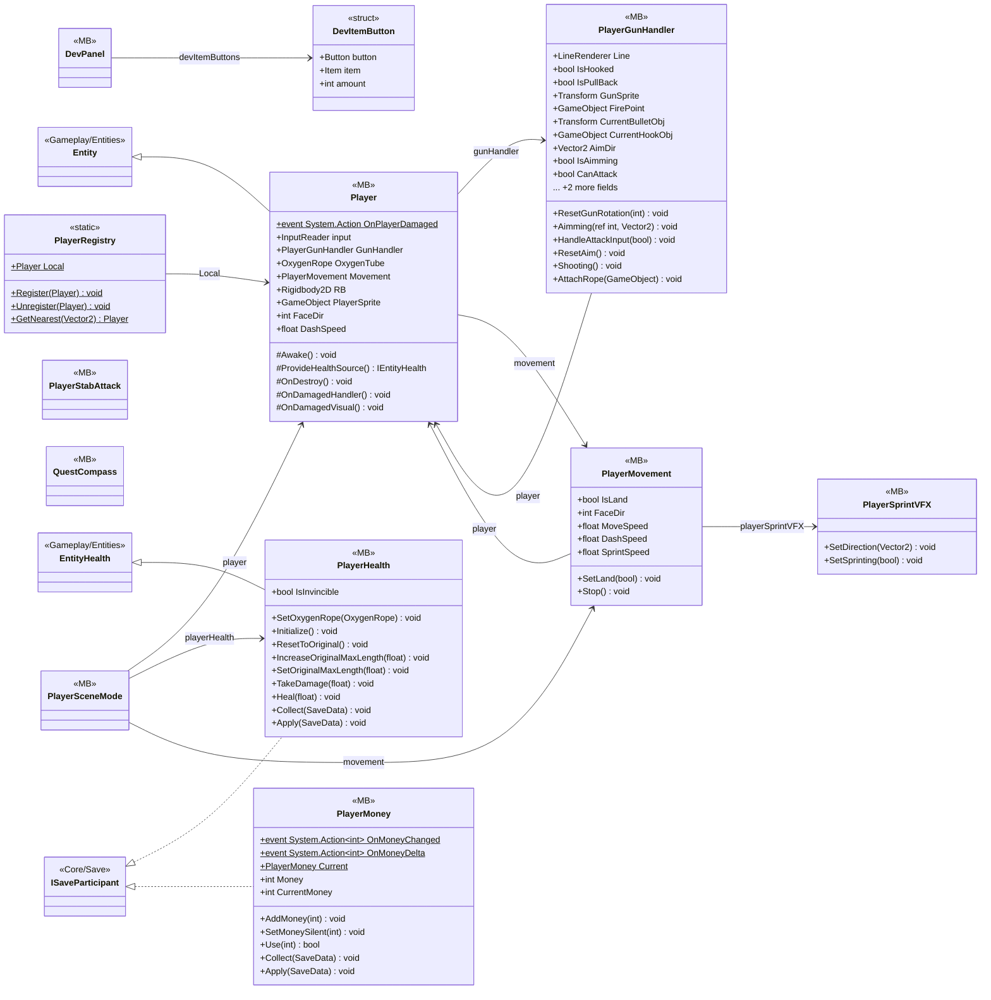

# Gameplay/Entities/Players

12 types · 871 LOC (non-blank) · depends on: [Core](Core.md) ×10, [Gameplay/AudioSetting](Gameplay_AudioSetting.md) ×6, [Gameplay/Entities](Gameplay_Entities.md) ×6, [Core/Events](Core_Events.md) ×5, [Core/Datas/Upgrades](Core_Datas_Upgrades.md) ×4, [Core/Save](Core_Save.md) ×4, [Gameplay/QuestSystems/Quest](Gameplay_QuestSystems_Quest.md) ×4, [Gameplay/Services](Gameplay_Services.md) ×4, [Core/Datas/Items](Core_Datas_Items.md) ×3, [Gameplay/Entities/Players/OxygenTube](Gameplay_Entities_Players_OxygenTube.md) ×3, [Core/Datas](Core_Datas.md) ×2, [Core/Inputs](Core_Inputs.md) ×2, [Core/Scenes](Core_Scenes.md) ×1, [Gameplay/Inventory](Gameplay_Inventory.md) ×1, [Gameplay/Items](Gameplay_Items.md) ×1, [Gameplay/MainCameras](Gameplay_MainCameras.md) ×1, [Gameplay/Projectiles](Gameplay_Projectiles.md) ×1, [Gameplay/RopeSystems](Gameplay_RopeSystems.md) ×1

[← index](../README.md)

## Event subscriptions

| Subscriber | Publisher | Event |
|---|---|---|
| Player | InputReader | OnAttacked |
| Player | InputReader | OnUseItem |
| PlayerHealth | UpgradeService | OnLevelGranted |
| PlayerMoney | RewardEvents | OnMoneyRewarded |
| PlayerMovement | InputReader | OnSprinted |

## Files

| Type | Kind | File | LOC |
|---|---|---|---|
| DevItemButton | struct | `DevPanel.cs:19` | 6 |
| DevPanel | MB | `DevPanel.cs:17` | 163 |
| Player | MB | `Player.cs:7` | 62 |
| PlayerGunHandler | MB | `PlayerGunHandler.cs:9` | 260 |
| PlayerHealth | MB | `PlayerHealth.cs:6` | 88 |
| PlayerMoney | MB | `PlayerMoney.cs:6` | 41 |
| PlayerMovement | MB | `PlayerMovement.cs:7` | 99 |
| PlayerRegistry | static | `PlayerRegistry.cs:6` | 18 |
| PlayerSceneMode | MB | `PlayerSceneMode.cs:8` | 49 |
| PlayerSprintVFX | MB | `PlayerSprintVFX.cs:6` | 48 |
| PlayerStabAttack | MB | `PlayerStabAttack.cs:8` | 18 |
| QuestCompass | MB | `QuestCompass.cs:21` | 25 |
