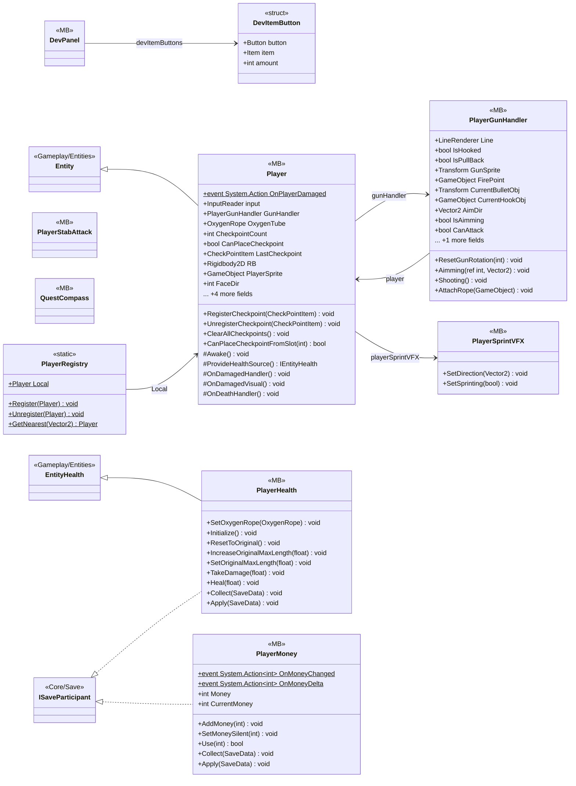

# Gameplay/Entities/Players

10 types · 1005 LOC (non-blank) · depends on: [Gameplay/QuestSystems/Quest](Gameplay_QuestSystems_Quest.md) ×6, [Gameplay/Services](Gameplay_Services.md) ×4, [Core/Datas/Items](Core_Datas_Items.md) ×4, [Core/Datas/Upgrades](Core_Datas_Upgrades.md) ×4, [Gameplay/Entities](Gameplay_Entities.md) ×4, [Core/Save](Core_Save.md) ×4, [Gameplay/Game](Gameplay_Game.md) ×3, [Gameplay/Entities/Players/OxygenTube](Gameplay_Entities_Players_OxygenTube.md) ×3, [Core](Core.md) ×3, [Core/Datas](Core_Datas.md) ×3, [Gameplay/Inventory](Gameplay_Inventory.md) ×2, [Gameplay/AudioSetting](Gameplay_AudioSetting.md) ×2, [Gameplay/InteractObjects](Gameplay_InteractObjects.md) ×2, [Core/Events](Core_Events.md) ×2, [Core/Scenes](Core_Scenes.md) ×1, [Core/Inputs](Core_Inputs.md) ×1, [Gameplay/MainCameras](Gameplay_MainCameras.md) ×1, [Gameplay/RopeSystems](Gameplay_RopeSystems.md) ×1, [Gameplay/Projectiles](Gameplay_Projectiles.md) ×1

[← index](../README.md)

## Event subscriptions

| Subscriber | Publisher | Event |
|---|---|---|
| Player | InputReader | OnAttacked |
| Player | InputReader | OnInteracted |
| Player | InputReader | OnSprinted |
| Player | InputReader | OnTeleport |
| Player | InputReader | OnUseItem |
| PlayerHealth | UpgradeService | OnLevelGranted |
| PlayerMoney | QuestManager | OnMoneyRewarded |

## Files

| Type | Kind | File | LOC |
|---|---|---|---|
| DevItemButton | struct | `DevPanel.cs:18` | 6 |
| DevPanel | MB | `DevPanel.cs:16` | 163 |
| Player | MB | `Player.cs:12` | 397 |
| PlayerGunHandler | MB | `PlayerGunHandler.cs:7` | 222 |
| PlayerHealth | MB | `PlayerHealth.cs:5` | 82 |
| PlayerMoney | MB | `PlayerMoney.cs:5` | 32 |
| PlayerRegistry | static | `PlayerRegistry.cs:5` | 18 |
| PlayerSprintVFX | MB | `PlayerSprintVFX.cs:3` | 48 |
| PlayerStabAttack | MB | `PlayerStabAttack.cs:6` | 18 |
| QuestCompass | MB | `QuestCompass.cs:20` | 25 |
