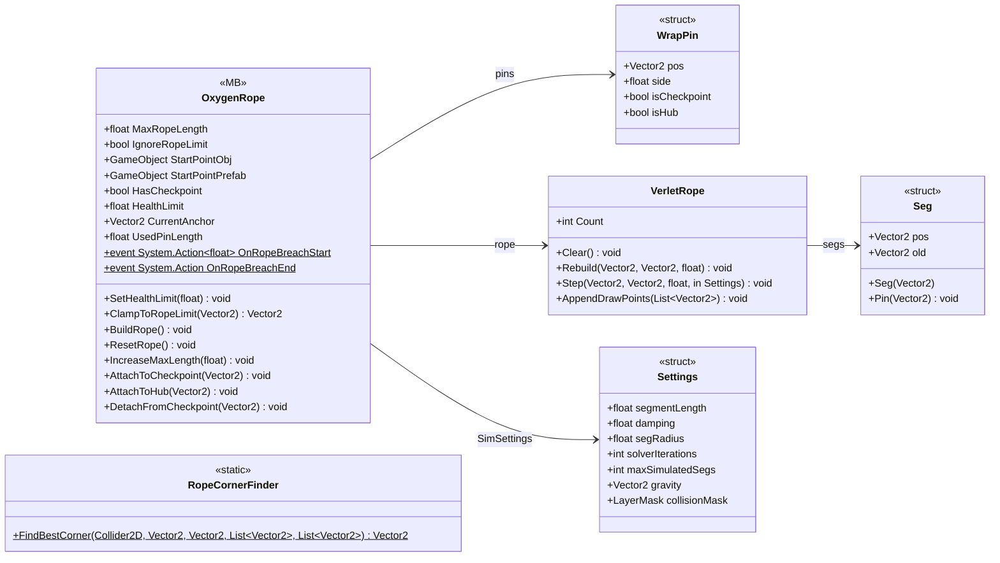

# Gameplay/Entities/Players/OxygenTube

6 types · 575 LOC (non-blank) · depends on: [Core/Events](Core_Events.md) ×2, [Core](Core.md) ×1, [Gameplay/Game](Gameplay_Game.md) ×1, [Gameplay/InteractObjects](Gameplay_InteractObjects.md) ×1

[← index](../README.md)

## Files

| Type | Kind | File | LOC |
|---|---|---|---|
| OxygenRope | MB | `OxygenRope.cs:8` | 364 |
| RopeCornerFinder | static | `RopeCornerFinder.cs:7` | 72 |
| Seg | struct | `VerletRope.cs:17` | 6 |
| Settings | struct | `VerletRope.cs:9` | 7 |
| VerletRope | class | `VerletRope.cs:7` | 139 |
| WrapPin | struct | `OxygenRope.cs:113` | 7 |
