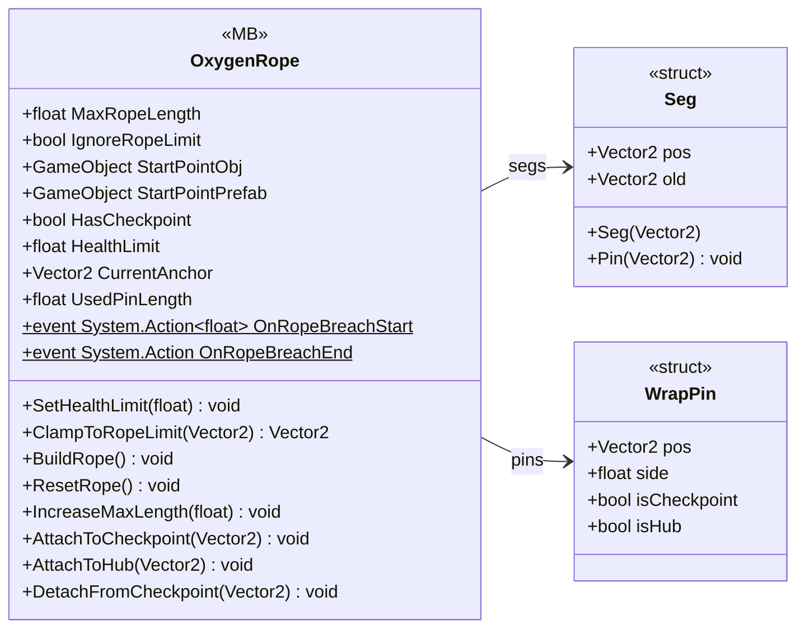

# Gameplay/Entities/Players/OxygenTube

3 types · 536 LOC (non-blank) · depends on: [Core/Events](Core_Events.md) ×2, [Gameplay/InteractObjects](Gameplay_InteractObjects.md) ×1, [Gameplay/Game](Gameplay_Game.md) ×1, [Core](Core.md) ×1

[← index](../README.md)

## Files

| Type | Kind | File | LOC |
|---|---|---|---|
| OxygenRope | MB | `OxygenRope.cs:8` | 536 |
| Seg | struct | `OxygenRope.cs:113` | 6 |
| WrapPin | struct | `OxygenRope.cs:120` | 7 |
