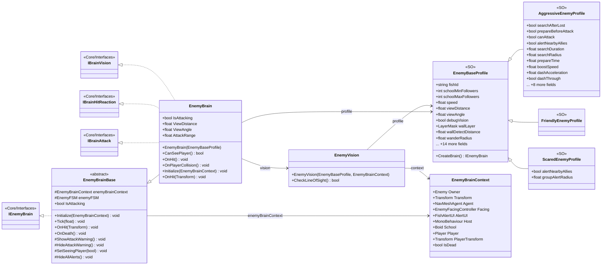

# Gameplay/Entitys/Enemys/Brain

8 types · 363 LOC (non-blank) · depends on: [Gameplay/Entitys/Enemys/Brain/FSM/States](Gameplay_Entitys_Enemys_Brain_FSM_States.md) ×6, [Core/Interfaces](Core_Interfaces.md) ×5, [Gameplay/Entitys/Enemys/NavAgents/Core](Gameplay_Entitys_Enemys_NavAgents_Core.md) ×3, [Gameplay/Entitys/Enemys/Brain/FSM](Gameplay_Entitys_Enemys_Brain_FSM.md) ×2, [Gameplay/Entitys/Enemys/Partbraked](Gameplay_Entitys_Enemys_Partbraked.md) ×1, [Gameplay/Entitys/Enemys/Beharviours](Gameplay_Entitys_Enemys_Beharviours.md) ×1, [Gameplay/Entitys/Enemys](Gameplay_Entitys_Enemys.md) ×1, [Gameplay/Entitys/Players](Gameplay_Entitys_Players.md) ×1, [Gameplay/Entitys/Enemys/NavAgents](Gameplay_Entitys_Enemys_NavAgents.md) ×1

[← index](../README.md)

## Files

| Type | Kind | File | LOC |
|---|---|---|---|
| AggressiveEnemyProfile | SO | `AggressiveEnemyProfile.cs:10` | 44 |
| EnemyBaseProfile | SO, abstract | `EnemyBaseProfile.cs:9` | 64 |
| EnemyBrain | class | `EnemyBrain.cs:5` | 134 |
| EnemyBrainBase | abstract | `EnemyBrainBase.cs:5` | 42 |
| EnemyBrainContext | class | `EnemyBrainContext.cs:9` | 13 |
| EnemyVision | class | `EnemyVision.cs:5` | 54 |
| FriendlyEnemyProfile | SO | `FriendlyEnemyProfile.cs:12` | 3 |
| ScaredEnemyProfile | SO | `ScaredEnemyProfile.cs:13` | 9 |
