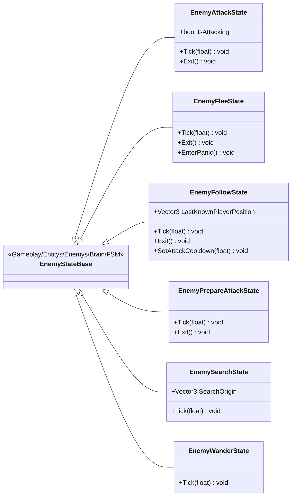

# Gameplay/Entitys/Enemys/Brain/FSM/States

6 types · 712 LOC (non-blank) · depends on: [Gameplay/Entitys/Enemys/Brain/FSM](Gameplay_Entitys_Enemys_Brain_FSM.md) ×18, [Gameplay/Entitys/Enemys/Brain](Gameplay_Entitys_Enemys_Brain.md) ×18, [Gameplay/Entitys/Enemys/NavAgents/Core](Gameplay_Entitys_Enemys_NavAgents_Core.md) ×6, [Gameplay/Entitys/Enemys/Beharviours](Gameplay_Entitys_Enemys_Beharviours.md) ×1, [Core/Interfaces](Core_Interfaces.md) ×1

[← index](../README.md)

## Files

| Type | Kind | File | LOC |
|---|---|---|---|
| EnemyAttackState | class | `EnemyAttackState.cs:5` | 125 |
| EnemyFleeState | class | `EnemyFleeState.cs:5` | 108 |
| EnemyFollowState | class | `EnemyFollowState.cs:6` | 223 |
| EnemyPrepareAttackState | class | `EnemyPrepareAttackState.cs:3` | 40 |
| EnemySearchState | class | `EnemySearchState.cs:9` | 62 |
| EnemyWanderState | class | `EnemyWanderState.cs:6` | 154 |
