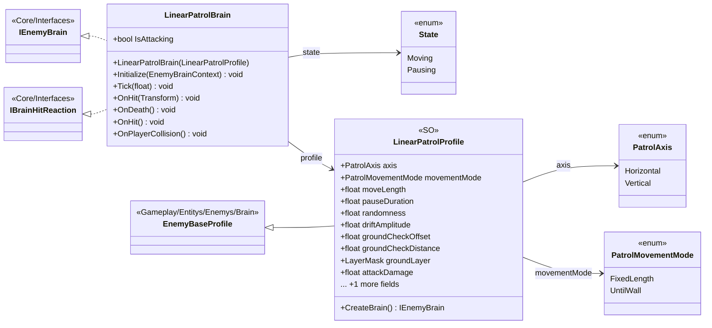

# Gameplay/Entitys/Enemys/Brain/LinearPatrol

5 types · 218 LOC (non-blank) · depends on: [Core/Interfaces](Core_Interfaces.md) ×3, [Gameplay/Entitys/Enemys/Brain](Gameplay_Entitys_Enemys_Brain.md) ×2, [Gameplay/Entitys/Enemys/Partbraked](Gameplay_Entitys_Enemys_Partbraked.md) ×1

[← index](../README.md)

## Files

| Type | Kind | File | LOC |
|---|---|---|---|
| LinearPatrolBrain | class | `LinearPatrolBrain.cs:5` | 179 |
| LinearPatrolProfile | SO | `LinearPatrolProfile.cs:16` | 30 |
| PatrolAxis | enum | `LinearPatrolProfile.cs:5` | 5 |
| PatrolMovementMode | enum | `LinearPatrolProfile.cs:10` | 4 |
| State | enum | `LinearPatrolBrain.cs:6` | 1 |
