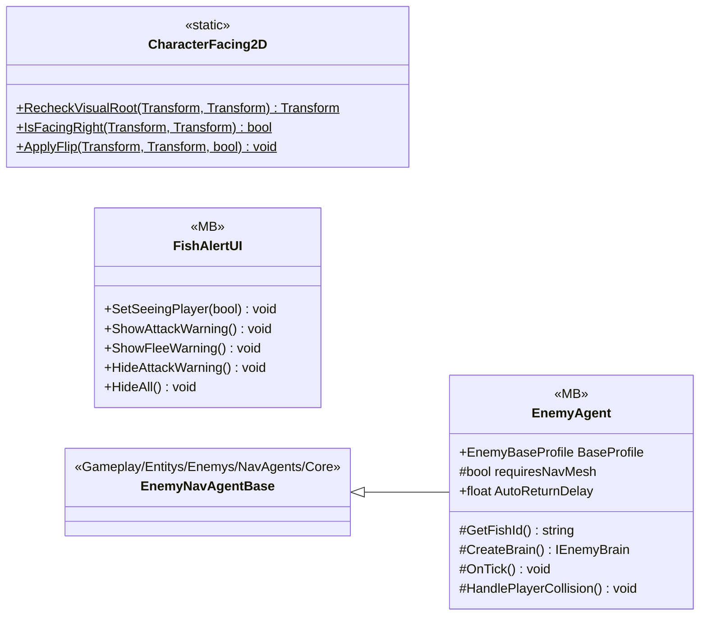

# Gameplay/Entitys/Enemys/NavAgents

3 types · 162 LOC (non-blank) · depends on: [Gameplay/Entitys/Enemys/Brain](Gameplay_Entitys_Enemys_Brain.md) ×3, [Core/Interfaces](Core_Interfaces.md) ×2, [Gameplay/Entitys/Enemys/NavAgents/Core](Gameplay_Entitys_Enemys_NavAgents_Core.md) ×1

[← index](../README.md)

## Files

| Type | Kind | File | LOC |
|---|---|---|---|
| CharacterFacing2D | static | `CharacterFacing2D.cs:8` | 33 |
| EnemyAgent | MB | `EnemyAgent.cs:5` | 28 |
| FishAlertUI | MB | `FishAlertUI.cs:6` | 101 |
